# 15 箱码放流程图解

先码第一层后排，再码第一层前排，最后码第二层靠后墙的一排。箱位编号表示每排的码放先后，摆完从左到右是 1、3、5、4、2。

每个箱位一张图。从左往右看 A1 找箱贴面、A2 吸住搬运、A3 落稳退开、B1 重看再贴，再看下方 B2 怎么推和怎么撤。

蓝绿表示左腕，紫色表示右腕。黄箱是本次码放的箱，灰箱是已放好的邻箱。吸盘实心表示吸住，空心表示开阀。俯视图中，朝上是往后墙，朝右是往右墙。图中放大了缝隙方便辨认。

A1 和 B1 都是先把工具移动到箱面附近，再慢慢贴上去。A1 在供料台上准备吸箱，B1 在落箱后重新找准要推的那一面。

| 状态 | 用一句话说 |
| --- | --- |
| S0 | 两杯都离开，箱底仍有支撑。 |
| S1 | 吸盘开阀贴着箱面，箱底有支撑。 |
| S2 | 至少一只吸盘吸住，箱底还在支撑面上。 |
| S3 | 箱底离开支撑，箱子由吸盘托住。 |

B2 推箱通常保持在 S1，碰到目标墙或邻箱、对齐箱边等条件决定下一步。上层短抬跨缝时，会经历 S2 吸住、S3 抬离、S2 落稳。最终确认 S0 后，机械臂去准备下一箱。

[第一层后排](#第一层后排) · [第一层前排](#第一层前排) · [第二层靠后墙](#第二层靠后墙)

## 第一层后排

### R1 第 1 箱（`Cube_1`）

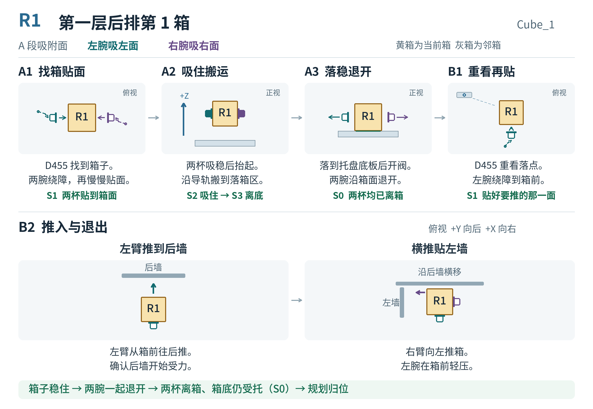

双腕吸住左右两面，把箱搬到托盘底板。左臂先把箱推到后墙，继续轻压。右臂把箱向左推贴左墙，箱子稳住后两腕一起退开。

### R2 第 2 箱（`Cube_2`）

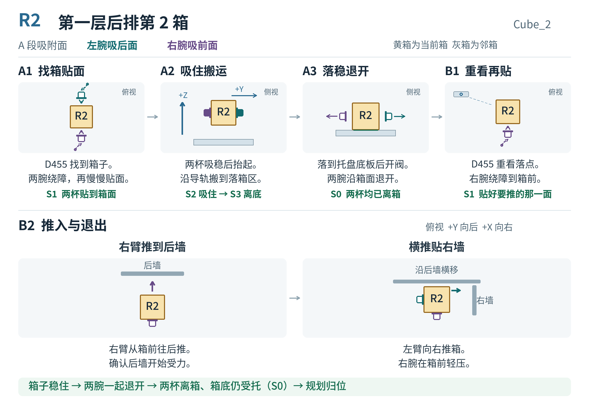

左腕吸后面，右腕吸前面，把箱搬到托盘底板。右臂先推到后墙并轻压，左臂再把箱推贴右墙。箱子稳住后，两腕一起退开。

### R3 第 3 箱（`Cube_3`）

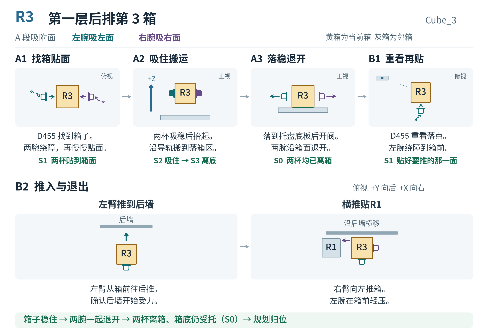

双腕吸住左右两面搬箱。左臂把箱推到后墙并继续轻压，右臂向左推，让这箱贴到已放好的 R1。确认箱子稳住，再撤两腕。

### R4 第 4 箱（`Cube_4`）

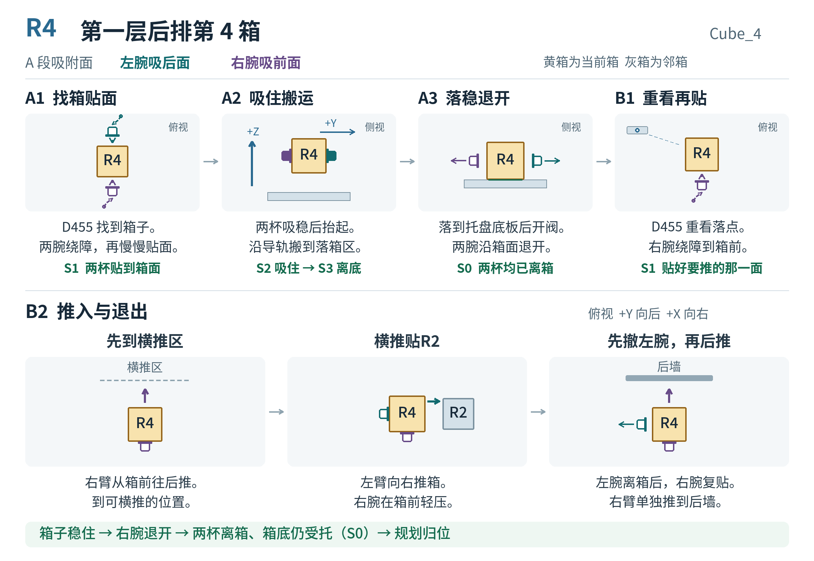

左腕吸后面、右腕吸前面搬箱。右臂先推到能横移的位置，左臂再向右推贴 R2。左腕退开后，右臂继续把箱推到后墙，稳住再退。

### R5 第 5 箱（`Cube_5`）

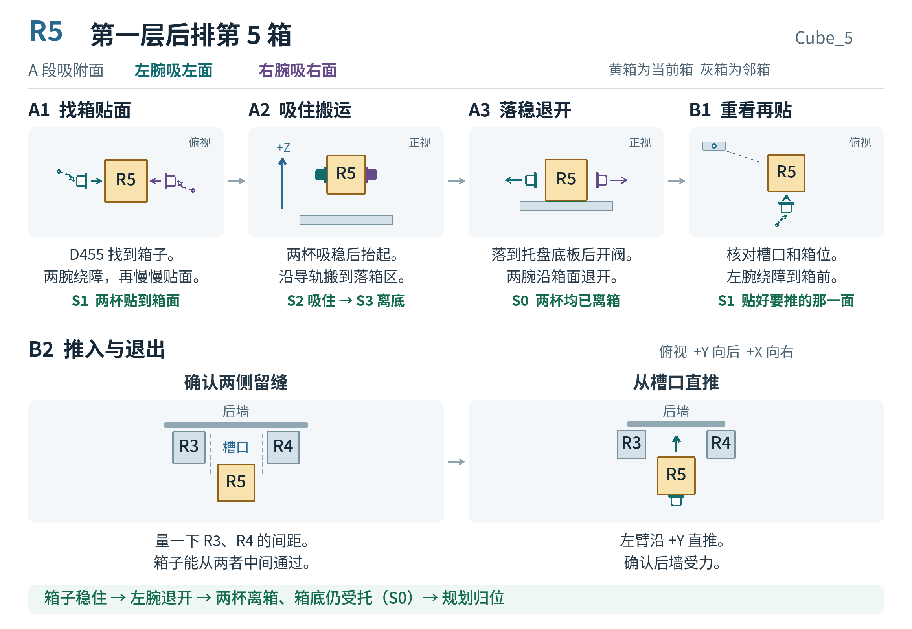

双腕吸住左右两面，把箱搬到 R3、R4 的槽口前。相机确认两侧都有余量后，左臂沿直线推到后墙。箱子稳住后，左腕退开。

## 第一层前排

### F1 第 1 箱（`Cube_12`）

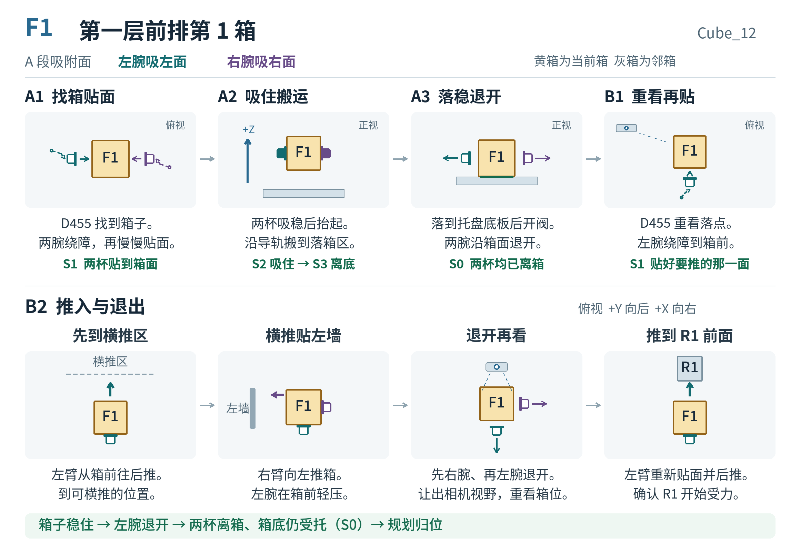

双腕吸住左右两面搬箱。左臂先向后推一段，右臂再向左推贴左墙。两腕退开让相机重看箱位，左臂重新贴面，把箱推到 R1 前面。

### F2 第 2 箱（`Cube_15`）

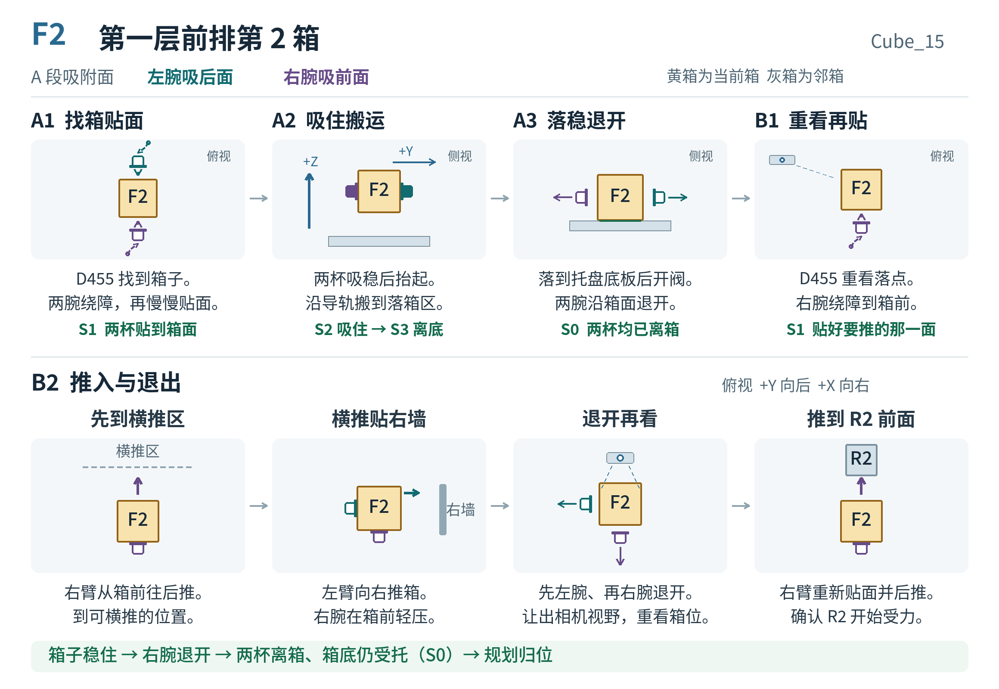

左腕吸后面、右腕吸前面搬箱。右臂先向后推一段，左臂再向右推贴右墙。两腕退开让相机重看箱位，右臂重新贴面，把箱推到 R2 前面。

### F3 第 3 箱（`Cube_13`）

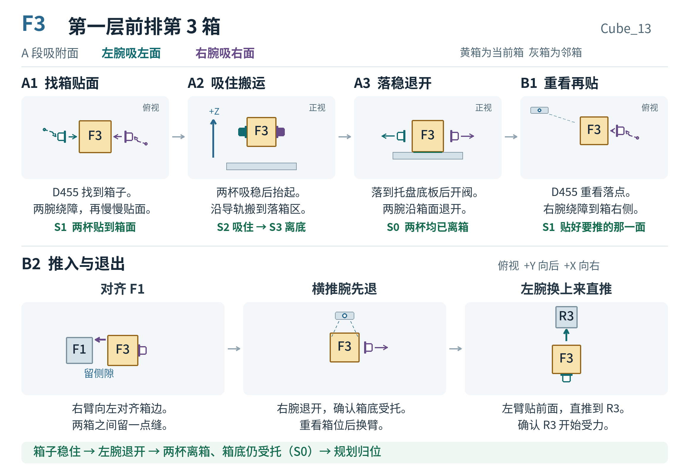

双腕吸左右两面搬箱。右臂先向左推，和 F1 的边缘对齐并留出侧隙。右腕退出，相机复核位置和朝向，左臂从箱前直推到 R3。

### F4 第 4 箱（`Cube_14`）

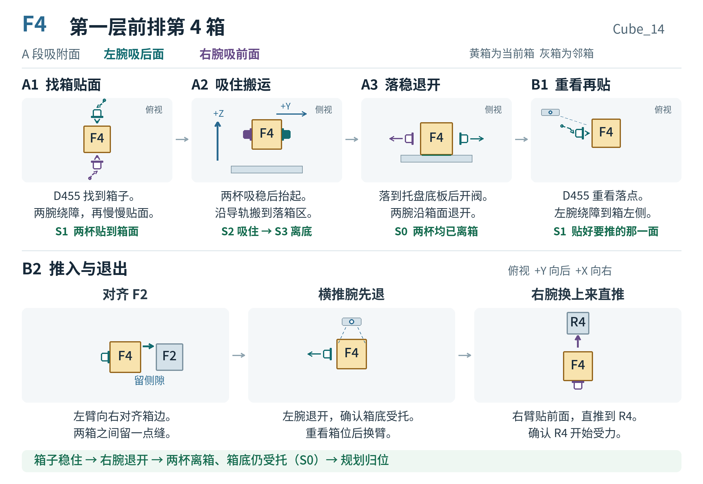

左腕吸后面、右腕吸前面搬箱。左臂先向右推，和 F2 的边缘对齐并留出侧隙。左腕退出，相机复核位置和朝向，右臂从箱前直推到 R4。

### F5 第 5 箱（`Cube_6`）

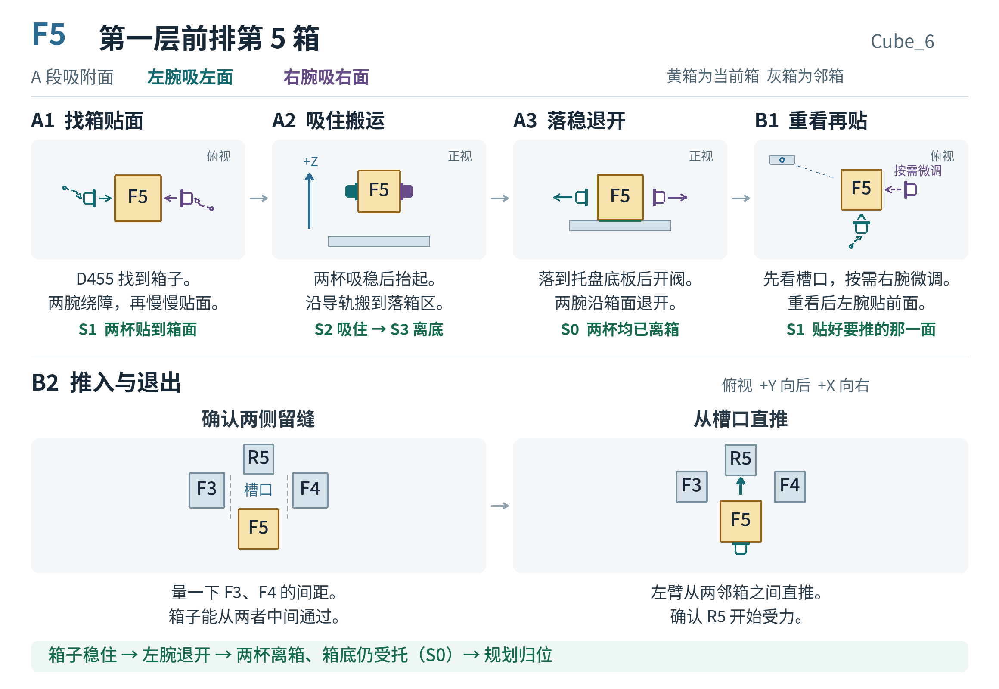

双腕吸住左右两面，把箱搬到 F3、F4 的槽口前。如果需要调位置且空间允许，右腕先轻推一下，退开后相机再看槽口。两侧都有余量后，左臂直推到 R5。

## 第二层靠后墙

### U1 第 1 箱（`Cube_7`）

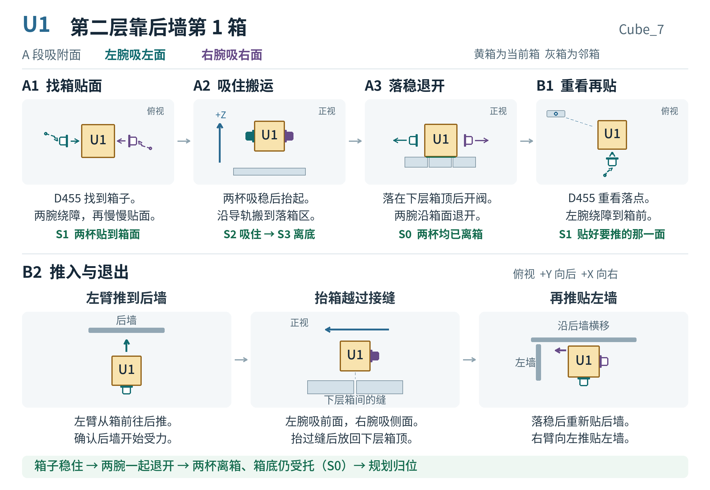

双腕吸住左右两面，把箱落到第一层箱顶。左臂先推到后墙，两腕再吸住前面和右侧，向左短抬跨过缝。落稳后重新贴后墙，右臂推贴左墙，两腕一起退开。

### U2 第 2 箱（`Cube_8`）

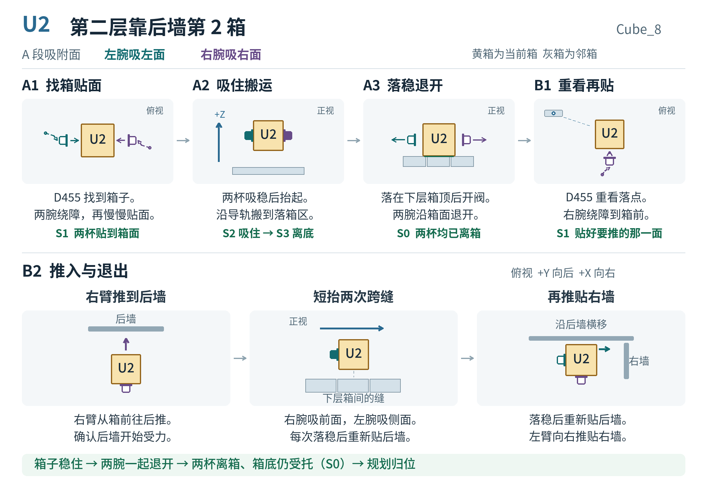

双腕吸住左右两面，把箱落到第一层箱顶。右臂先推到后墙，两腕再吸住前面和左侧，分两次向右短抬跨缝。每次落稳都恢复后墙接触。最后左臂推贴右墙，两腕一起退开。

### U3 第 3 箱（`Cube_9`）

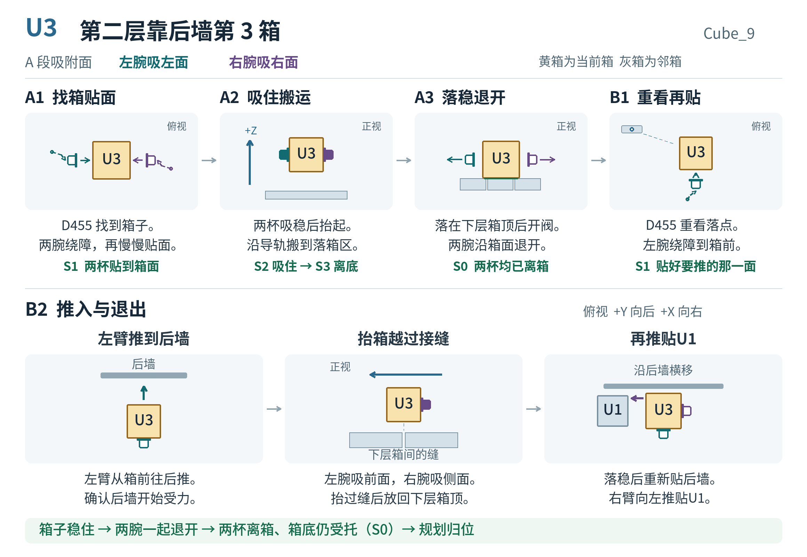

双腕吸住左右两面，把箱落到第一层箱顶。左臂先推到后墙，两腕吸住前面和右侧，向左短抬跨缝。落稳后重新贴后墙，右臂把箱推贴 U1，两腕一起退开。

### U4 第 4 箱（`Cube_10`）

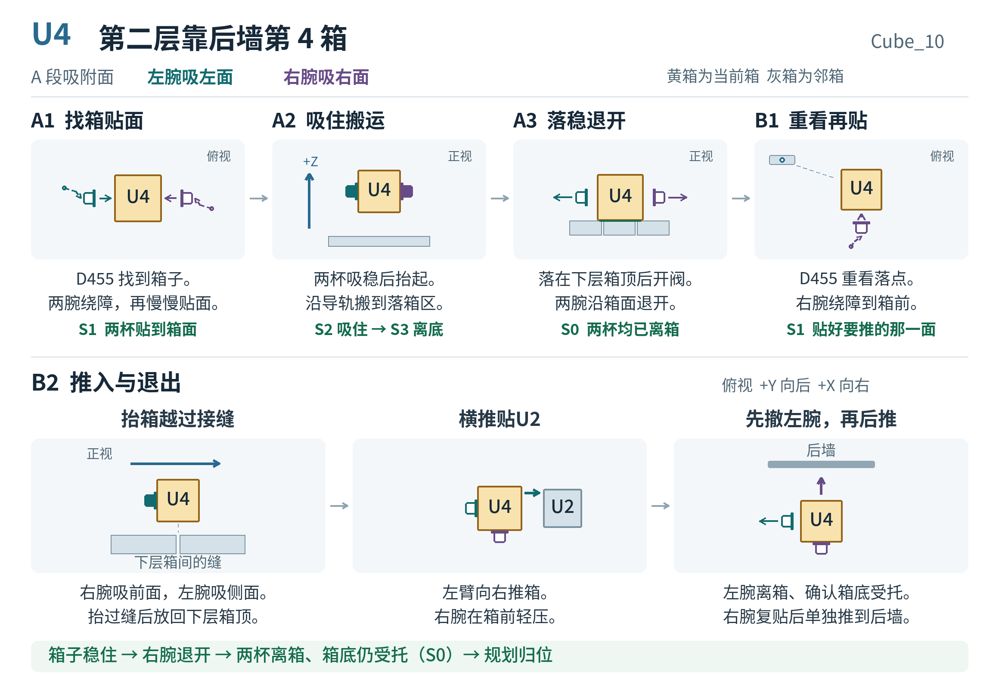

双腕吸住左右两面，把箱落到第一层箱顶。右腕贴前面，左腕贴左侧，两腕侧吸向右跨缝。左臂推贴 U2 后先退开，右臂再单独推到后墙，箱子稳住后撤离。

### U5 第 5 箱（`Cube_11`）

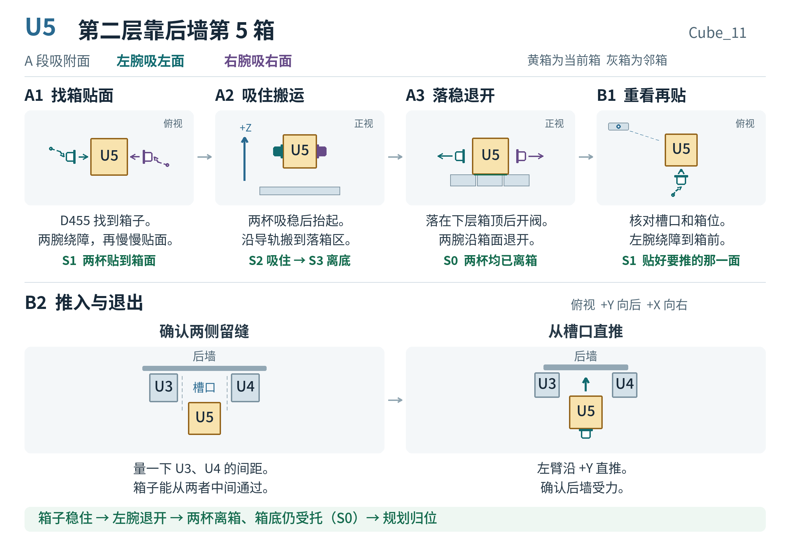

双腕吸住左右两面，把箱落到 U3、U4 的槽口前。相机确认两侧都有余量，左臂直推到后墙。箱子稳住后，左腕沿来路退开。

[状态与技能的技术定义](long_skill_short_state.md) · [逐箱技术运行线](long_skill_short_state_routes.md) · [Isaac Sim 实跑记录](observed_skills_validation.md)
