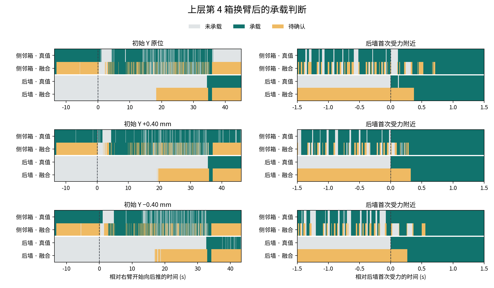

# 上层第 4 箱换臂后的侧邻箱与后墙承载

左臂沿 +X 把 Cube_10 推向侧邻箱 Cube_8，卸载撤离后，右臂沿 +Y 将 Cube_10 推到后墙。箱底受支且吸盘仍在传力时，一向承载为 S5，侧邻箱与后墙同时承载为 S6。撤臂后箱间仍可传力，工具已分离的主状态为 S0。这里同时评估外部接触对象和主状态。[冻结的试验方案](protocol.md)

**三次独立复跑都确认了后墙开始承载，三次都在真实初触后 0.283–0.392 s 给出确认。侧邻箱的承载仍有明显漏检，集中在左臂卸载到右臂开始向后墙推进的间隔。** 右臂后推期间共出现 322 个 S6 真值步，新融合器正确检出 188 步（58.39%），这 188 步都同时报对了两个接触对象。旧融合器在同一批记录上检出 0 步。

三次均从实测断点独立启动，同一时刻仅运行一个 Isaac Sim。各箱最后均达到 `SEATED_STABLE`，撤臂后的 60 个落稳采样步全部受支，最终箱心距各自目标 0.647–0.663 mm。共取得 51,937 个 120 Hz 配对步。[原始报告摘录、断点及校验值](physical_outcomes.json)

## 后墙什么时候开始受力

下表以右臂开始沿 +Y 推进为零点。真实初触和法向力达到 1 N 分别列出。确认时差为三步融合确认时刻减去 PhysX 首次承载时刻，负值表示早报。三次新融合器均在仍然推进、尚未撤压时确认，且后推段逐步对照中均未出现后墙误报。

| 初始 Y | 真实初触 (s) | 后墙达到 1 N (s) | 融合确认 (s) | 新判据时差 (s) | 旧判据时差 (s) |
| --- | ---: | ---: | ---: | ---: | ---: |
| 原位 | 34.183 | 34.200 | 34.575 | +0.392 | −0.500 |
| 向后墙 0.40 mm | 35.475 | 35.475 | 35.817 | +0.342 | −4.467 |
| 远离后墙 0.40 mm | 32.567 | 32.575 | 32.850 | +0.283 | −2.308 |

## 侧邻箱在换臂后是否还承载

换臂间隔从左臂开始卸载到右臂开始后推。三次共 4,945 步，PhysX 在 4,919 步记录到侧邻箱仍受力。融合器确认 227 步（4.61%），4,648 步给出待确认，44 步误判为未承载。侧向力位于 0.1 至不足 1 N 的 4,452 步中，只有 34 步被确认。此时单凭箱面在图像中相邻，难以判断其间是否传力。

| 初始 Y | 换臂间隔，真实承载步 / 全部步 | 换臂间隔，检出 / 真实承载 | 右臂后推，检出 / 真实侧承载 | 右臂后推，误报 / 真实未承载 | 侧邻箱重新受力至融合确认 (s) |
| --- | ---: | ---: | ---: | ---: | ---: |
| 原位 | 1,647/1,647 | 76/1,647 | 2,066/3,200 | 75/1,021 | +2.292 |
| 向后墙 0.40 mm | 1,621/1,647 | 74/1,621 | 2,197/3,537 | 60/827 | +2.700 |
| 远离后墙 0.40 mm | 1,651/1,651 | 77/1,651 | 1,914/2,868 | 102/1,149 | +2.158 |

右臂后推阶段侧承载会间歇消失。新融合器在真正承载的 9,605 步中检出 6,177 步（64.31%），在未承载的 2,997 步中误报 237 步（7.91%）。表中重新受力取换臂开始后首次连续三个物理步卸载之后的首次回载，再与融合器首次连续三步报承载对齐。间歇回载包含多个短脉冲，这项时差不能解释为每个短脉冲都被辨识。

## S5 和 S6 能分清到什么程度

只统计右臂后推段。每个单元格保留步数，召回的分母是该类全部真值步，精确率的分母是有真值时预测为该类的步数。

| 初始 Y | 新 S5 召回 | 新 S5 精确率 | 新 S6 召回 | 新 S6 精确率 | 旧 S6 召回 |
| --- | ---: | ---: | ---: | ---: | ---: |
| 原位 | 1,093/3,110 | 1,093/1,168 | 60/104 | 60/60 | 0/104 |
| 向后墙 0.40 mm | 1,209/3,429 | 1,209/1,269 | 69/108 | 69/69 | 0/108 |
| 远离后墙 0.40 mm | 1,003/2,758 | 1,003/1,115 | 59/110 | 59/59 | 0/110 |
| 三次合计 | 35.55% | 93.05% | 58.39% | 100% | 0% |

从断点恢复至撤臂落稳的整个片段内，新融合器识别出 410/551 个 S6 步。该数字含卸压期间同时受力的时刻。图左以右臂开始后推为零点，图右放大各次后墙首次承载前后 1.5 s 的变化。所有比率按步计算，独立样本是三次小幅 Y 偏移条件下的物理运行。



逐步时间线与打分可按试次核查。[原位评分](nominal/scores.json) · [原位时间线](nominal/timeline.csv.gz) · [向后墙偏移评分](forward04/scores.json) · [向后墙偏移时间线](forward04/timeline.csv.gz) · [远离后墙评分](back04/scores.json) · [远离后墙时间线](back04/timeline.csv.gz)

## 评分方法

参考线用每个 1/120 s 物理步的接触对、法向冲量及其轴向投影判定侧面与后墙承载。沿用七状态真值的最小法向冲量 `1e-5 N·s`。有接触记录但缺少当步冲量时保留为待确认。后墙物理起点取后墙首次实际承载的一步，观测确认取连续三步报后墙时的第三步。时间以仿真秒计。

实验线顺序接收 D455 的 ArUco 观测及双腕在 TCP 处的受力。静置侧邻箱的位置取自已收到的图像。换臂后，估计器参考侧向间隙、横向腕力和绕竖直轴的力矩。靠近后墙时，用右臂实际下发的微进给与编码器位移、轴向力增量联合确认。原有七状态融合器与新融合器在同一记录上旁路评分。主状态的召回分母包括观测器弃判的已知真值步。精确率只在有真值且报出该类的步上计算。

估计器输入与执行器的终止条件有一个重要区别。原执行器在推程中用真实托底及推杯接触检查调节进给，用后墙真实承载参与决定何时结束推程。因此单列右臂仍在推进时的首次确认，撤臂后的数据另列。[原执行器的后推逻辑](../../../upper_slot4_front_seal.py)

## 复算

在创新点二分支的仓库根目录运行。逐步数据包随试验归档，包含带时间戳的相机识别结果、腕力、运动学和独立物理参考。复算评分使用系统 Python 和 NumPy。

```bash
e=scenes/w760_300mm_two_layer/experiments
r="$e/results/u4_handover"
out=$(mktemp -d)
for trial in nominal forward04 back04; do
  OPENBLAS_NUM_THREADS=1 python3 "$e/u4_handover_score.py" \
    "$r/$trial/paired.jsonl.gz" "$r/$trial/right_commands.json.gz" "$out/$trial"
done
python3 "$e/u4_handover_plot.py" "$out"
```

重新采集使用 Isaac Sim 4.5.0。下面会在新目录依次启动并关闭三个物理试次，每次只有一个 Kit 进程。每次均从第 4 箱断点恢复，到本箱撤臂且稳定就位结束。

```bash
s=scenes/w760_300mm_two_layer
sim=/home/ubuntu2004/isaacsim-4.5.0
session=$(mktemp -d)
python3 "$s/experiments/u4_handover_capture.py" "$sim/python.sh" "$session/runs"
for trial in nominal forward04 back04; do
  run="$session/runs/$trial"
  python3 "$s/experiments/seven_dataset.py" "$run" u4 "$run/paired.jsonl.gz"
  python3 "$s/experiments/u4_command_y.py" "$run" "$run/paired.jsonl.gz" "$sim" "$run/right_commands.json.gz"
  OPENBLAS_NUM_THREADS=1 python3 "$s/experiments/u4_handover_score.py" \
    "$run/paired.jsonl.gz" "$run/right_commands.json.gz" "$run"
done
```
