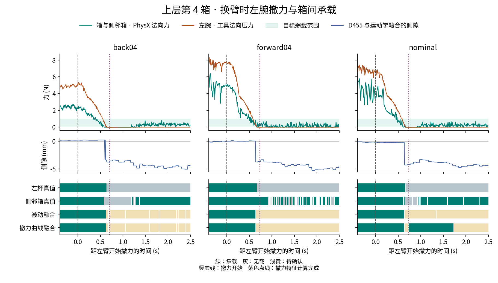

# 上层第 4 箱的撤力曲线与箱间侧载

左臂先沿 +X 将活动箱 Cube_10 压向侧邻箱 Cube_8，再沿 −X 撤力 3 mm，持续 1.5 s。随后左臂后撤抬起，右臂沿 +Y 向后墙推。两路估计读取各自时刻已经收到的传感数据。在每条独立仿真轨迹上，将原被动融合与加入左臂撤力曲线后的融合分别对照相同的 PhysX 真值。[试验方案](protocol.md)

**左臂撤力曲线在换臂阶段增加了弱侧载召回，也增加了无载误报。** 与原被动融合相比，换臂弱载召回提高 2.12 个百分点，误报率提高 3.38 个百分点。三次实际到达换臂的运行都出现过箱间失载，两条估计线均漏掉了首次失载。后推阶段的 S5 和 S6 在两条线上逐步一致。

## 计时与评价口径

撤力开始作为仿真时间零点。左杯与活动箱、活动箱与侧邻箱是两对不同的接触。后者的法向冲量按每步 1/120 s 换算成力。侧载下降到 0.1 N 以下时只要仍在传力，仍属承载。主要失载事件取连续三步明确无侧载的首次区间，同时列连续十二步的结果，以便辨别短暂失载和重新贴靠。侧隙由 D455 位姿和工具运动学补偿共同估计，保留图像测量与工具位置推算的误差。近零或略负的间隙本身不足以证明传力。

S5 表示工具仍接触、箱底有支撑且一个水平方向承载。S6 表示侧邻箱与后墙同时承载。召回率以全部该类真值步为分母，误报率以全部其他已知状态步为分母。两路待确认的样本均保留在分母内。每次物理运行独立初始化，表中的物理步来自连续时间序列。

## 撤力曲线怎样进入判断

原被动融合照常运行。新增判据在左腕法向压力依次越过约 4、2、1 N 并降到约 0.22 N 后才形成一次判断。它取 2 N 至近零段的左 TCP 实测法向退让量，以及 2 至 1 N 段的右腕 X 向力。D455 必须有已送达的有效观测，侧邻箱估计间隙绝对值不超过 12 mm，且右杯仍贴住箱前面。历史校准目标是判定当步起 12 个物理步内至少 7 步的侧邻箱是否承载。用于判别的特征截至判定当步。

12 个历史试次各提供一次有标签的撤力事件，6 次主要承载、6 次主要无载。按整条轨迹留一，在 6 次承载中，判对 3 次、误判为无载 1 次、待确认 2 次。在 6 次无载中，判对 5 次、待确认 1 次。两特征的选择也用过历史记录，因此这组数字只用于说明校准情况。独立复跑前已固定参数。新判断只补充原被动融合待确认的步，最多沿用 1 s，出现相反观测、侧隙明显变化或右臂移动时即失效。[校准方法](../u4_left_unload_calibration.md) · [校准数据与系数](../u4_left_unload_calibration.json) · [观察器](../../u4_left_unload_observer.py)

## Isaac Sim 独立复跑结果

从同一个上层第 4 箱断点串行运行四次。使用原有 −X 撤力和 +Y 后推，并保留既有腕力上限。实际走到换臂的试次有三次，其中原位和 −0.40 mm 两次最终稳定就位。首次 +0.40 mm 运行在后推途中中断，保留实际记录的 13,451 个同步步，其中 1,411 步进入后推。其补跑在左臂横推阶段以 9.220 N 触发原腕力上限，未进入换臂。三个到达换臂的试次均进入换臂和已观测后推的分母。后推 S6 的 267 个真值步来自两个独立的完整试次。[物理结果与来源哈希](physical_outcomes.json)

| 窗口与指标 | 召回率 被动 → 撤力融合 | 变化（百分点） | 误报率 被动 → 撤力融合 | 变化（百分点） |
| --- | ---: | ---: | ---: | ---: |
| 左杯卸载后 1 s，弱侧载 | 2/164（1.22%） → 67/164（40.85%） | +39.63 | 3/145（2.07%） → 31/145（21.38%） | +19.31 |
| 换臂期，弱侧载 | 73/3,299（2.21%） → 143/3,299（4.33%） | +2.12 | 9/829（1.09%） → 37/829（4.46%） | +3.38 |
| 换臂期，S5 | 240/4,117（5.83%） → 331/4,117（8.04%） | +2.21 | 9/829（1.09%） → 37/829（4.46%） | +3.38 |
| 后推期，S5 | 2,879/6,792（42.39%） → 2,879/6,792（42.39%） | +0.00 | 193/2,972（6.49%） → 193/2,972（6.49%） | +0.00 |
| 后推期，S6 | 148/267（55.43%） → 148/267（55.43%） | +0.00 | 0/9,497（0.00%） → 0/9,497（0.00%） | +0.00 |

弱载召回分母只包含侧邻箱在 0.1 至不足 1 N 传力的步。对应误报分母为明确无侧载的步。S5 与 S6 的误报分母为其他已知接触状态。换臂期未记录 S6 真值，因此无换臂 S6 召回率。所有新增命中和误报均来自原位试次。弱载召回的增量反映同一次撤力后的若干连续物理步。[汇总计数](summary.json)

## 失载时序

时刻均相对左臂开始沿法向撤力。失载起点是首次满足持续条件的第一个明确无载步，确认时刻为第三步。表中 8 秒左右的首报都在首次失载区间之后，并且三步内各自包含仍在承载的物理步。将首次失载的持续条件延长到 12 步，三次首段仍都漏检。

| 试次 | 左杯确认卸载（s） | 首次侧失载（起点 / 确认，s） | 首次侧回载确认（s） | 两路首次报失载（被动 / 撤力，s） | 新判据命中首次失载 |
| --- | ---: | ---: | ---: | ---: | ---: |
| [nominal](nominal/counts.json) | 0.683 | 0.650 / 0.667 | 0.967 | 8.058 / 8.058 | 否 |
| [forward04](forward04/counts.json) | 0.692 | 0.925 / 0.942 | 1.042 | 8.025 / 8.025 | 否 |
| [back04](back04/counts.json) | 0.658 | 0.583 / 0.600 | 1.208 | 8.025 / 8.025 | 否 |

一次撤力曲线计算的即时结果如下，供区分回弹特征、判定延迟和箱间物理状态。

| 试次 | 撤力判据出结果时间（s） | 当步侧向力（N） | 评分 | 判定 |
| --- | ---: | ---: | ---: | --- |
| nominal | 0.733 | 0.000 | 1.487 | 承载 |
| forward04 | 0.733 | 0.167 | 0.571 | 待确认 |
| back04 | 0.700 | 0.000 | 0.444 | 待确认 |



## 三个关键时刻在日志中的区别

原位试次首次失载起于 0.650 s，左杯直到 0.683 s 才连续三步卸载。0.733 s 时，撤力曲线将箱间判为承载，PhysX 当步却记录 0 N，随后 12 步只有 1 步承载。两箱在 0.967 s 再次连续三步传力。新增判断在同一次运行中一共补报了 119 步，其中 91 个承载步命中，70 步在 0.1 至不足 1 N 区间，另有 28 个明确无载步被误报为承载。两路在 8.058 s 才首次连续三步报失载，其中两步仍有弱于 0.1 N 的实际承载。

首次向后墙偏移 0.40 mm 的试次，左杯已卸载时，两箱仍承载 0.167 N，曲线评分为 0.571，给出待确认。远离后墙 0.40 mm 的试次，曲线评分为 0.444，判定当步两箱已失载，仍给出待确认。三次中，D455 结合运动学估计的侧隙介于 −4.18 mm 和 −3.62 mm，包含确实承载和确实脱开的情形。箱面距离可用于排除明显远离的情况，毫米量级的侧隙估计仍无法分辨这两类微小变形下的接触。

原位试次错过了振荡再贴靠前的短时失载。1 s 内复用一次撤力读数，会在回载后补中部分弱侧载，也会延续错误的有载判断。该观察器在换臂局部产生预测。后墙的判定继续使用原有右臂进给和腕力条件。

## 复算与重新采集

在仓库根目录执行。逐次重新评分使用已打包的传感记录、控制器右臂 Y 指令与物理参考。评分只改写每次的派生结果。

```bash
e=scenes/w760_300mm_two_layer/experiments
r="$e/results/u4_left_unload"
for paired in "$r"/*/paired.jsonl.gz; do
  python3 "$e/u4_left_unload_score.py" "$(dirname "$paired")"
done
python3 "$e/u4_left_unload_score.py" --summary "$r"
python3 "$e/u4_left_unload_plot.py" "$r"
```

重新采集用一个新目录。命令逐次等待前一个 Isaac Sim 退出。打包命令中的 Isaac 安装目录用于计算已下发右臂指令对应的末端位置。

```bash
e=scenes/w760_300mm_two_layer/experiments
isaac_dir=/home/ubuntu2004/isaacsim-4.5.0
run_dir=$(mktemp -d)/left-unload
python3 "$e/u4_handover_capture.py" --left-unload "$isaac_dir/python.sh" "$run_dir"
for report in "$run_dir"/*/runner_report.json; do
  trial=$(dirname "$report")
  out="$run_dir/paired/$(basename "$trial")"
  python3 "$e/seven_dataset.py" "$trial" u4 "$out/paired.jsonl.gz" --allow-incomplete
  python3 "$e/u4_command_y.py" "$trial" "$out/paired.jsonl.gz" "$isaac_dir" "$out/right_commands.json.gz"
  python3 "$e/u4_left_unload_score.py" "$out"
done
python3 "$e/u4_left_unload_score.py" --summary "$run_dir/paired"
```

首次 +0.40 mm 试次的进程在后推期间结束，三份 gzip 流未正常封口。三个流分别从原始文件提取完整 JSON 行，取共有的 13,451 步，并逐步检查时间戳、双腕六维力与 TCP 位置的一致性。恢复工具使用临时副本供标准打包器读取，记录原始文件哈希。新建输出文件夹的名称应是 `forward04`。[恢复记录](forward04/recovery.json)

```bash
staging=$(mktemp -d)
python3 "$e/u4_recover_prefix.py" ../runs/u4-left-unload/session-01/forward04 \
  "$isaac_dir" "$staging/forward04"
python3 "$e/u4_left_unload_score.py" "$staging/forward04"
```
