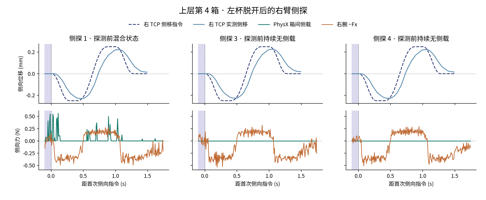

# 上层第 4 箱脱杯后的右臂侧向探测

用上层第 4 箱完成过缝后的同一实测断点，先独立复跑无探测对照，再测试左杯卸载后右臂的一次小幅侧向微动。全部使用 120 Hz PhysX 步进、原 D455 视觉和双臂六维腕力。试次串行启动。[实验方案](protocol.md) · [前一轮复跑](../u4_preload_repeat/README.md)

## 无探测物理对照

相同的 +0.40 mm 输入下得到清楚的两类窗口。对照 1 在撤力后 0.550 s 开始持续失载，换臂期内连续 1,582 步（13.183 s）。对照 3 左杯脱开后的首 1.5 s 全程有载，随后在撤力后 7.992 s 出现首次持续 18 步的失载，并在 8.350 s 首次持续回载 18 步。

四次共取得 62,988 个同步物理步，三个试次完成换臂。表中 0.9 s 窗口取左臂开始撤力后第 97 至第 108 步。按与探测前同样的严格左杯脱开条件核查，三个完整试次的 12 步均成立。[运行清单与断点哈希](physical_outcomes.json)

| 试次 | 初始 Y 偏置 | 0.9 s 窗口侧载（有载步 / 总步，平均力） | 换臂最长连续失载 | 运行结局 |
| --- | ---: | --- | ---: | --- |
| [对照 1](control_1/control_phys.json) | +0.40 mm | 0/12，0 N | 1,582 步 | 稳定就位 |
| [对照 2](control_2/handoff_counts.json) | +0.40 mm | — | — | 换臂前左腕 9.172 N 停止 |
| [对照 3](control_3/control_phys.json) | +0.40 mm | 12/12，0.691 N | 18 步 | 稳定就位 |
| [对照 4](control_4/control_phys.json) | 0.00 mm | 0/12，0 N | 921 步 | 稳定就位 |

| 对照 | PhysX 首次持续失载 | 失载确认延迟（被动 / 腕力与运动） | PhysX 首次持续回载 | 回载确认延迟（被动 / 腕力与运动） |
| --- | --- | --- | --- | --- |
| [1](control_1/handoff_counts.json) | 0.550 s / 1,582 步 | 7.492 s / 7.492 s | 18.600 s / 37 步，已开始后推 | 16.7 ms / 16.7 ms |
| [3](control_3/handoff_counts.json) | 7.992 s / 18 步 | 58.3 ms / 58.3 ms | 8.350 s / 18 步 | 漏检 / 16.7 ms |
| [4](control_4/handoff_counts.json) | 0.608 s / 921 步 | 漏检 / 7.592 s | 8.533 s / 26 步 | 均漏检 |

以换臂期为窗口，被动融合和腕力与运动融合的首次失载命中分别为 2/3、3/3，首次回载为 0/2、1/2。计入后推阶段的首次回载，分别为 1/3、2/3。换臂误报承载从 32/2,957（1.08%）增加到 55/2,957（1.86%），连续三步误报警从 0 次增至 2 次。两种方法的误报脱开均为 4/1,985（0.20%）。

## 脱杯后右臂侧探

前两次沿用 +0.40 mm 初始输入。第一次完成侧探且稳定就位，探测前 12 步已有承载与无载交替。第二次在左杯撤力前因左腕达到 9.089 N 停止，未执行探测。随后用同一断点的原位补采无载条件。为补连续承载的样本，另试了有历史承载样本的 −0.40 mm，结果仍是无载，之后用本次已取得持续承载对照的 +0.40 mm 再试一次。每次均按照固定横移边界保留实际状态。

| 试次 | 初始 Y 偏置 | 横移前真值（12 步） | 首次横移 | 运行结局 |
| --- | ---: | --- | ---: | --- |
| [侧探 1](probe_1/probe_counts.json) | +0.40 mm | 4 步承载、8 步无载，混合 | 0.908 s | 侧探完整，稳定就位 |
| [侧探 2](probe_2/probe_counts.json) | +0.40 mm | — | — | 撤力前左腕 9.089 N 停止 |
| [侧探 3](probe_3/probe_counts.json) | 0.00 mm | 12 步均无侧载 | 0.908 s | 侧探完整，后推时右腕 9.935 N 停止 |
| [侧探 4](probe_4/probe_counts.json) | −0.40 mm | 12 步均无侧载 | 0.908 s | 侧探完整，稳定就位 |
| [侧探 5](probe_5/probe_counts.json) | +0.40 mm | — | — | 撤力前左腕 9.132 N 停止 |

侧探 3 和 4 在横移前 12 步和基线保持前 12 步均无侧载，各自的 180 个运动与归位步也无箱间承载。活动箱的 X 位移峰峰值分别约为 0.82 µm 和 1.25 µm。两次右腕均记录到 0.34–0.37 N 的卸载幅度和约 0.53 N 的回向零位力增量。箱间侧载为零时，前侧工具仍能测得这类横向力响应。冻结的主动判据在两次均返回待确认，被动融合在首个横移命令前也给出待确认。[侧探 3 逐步信号](probe_3/probe_timeline.csv.gz) · [侧探 4 逐步信号](probe_4/probe_timeline.csv.gz)



阴影是每次首个横移命令前的 12 个物理步，箱间原有承载按这段 PhysX 记录评分。混合试次在运动期有 27 步承载，最长连续 7 步。它的运动前真值仍按 4/12 步承载记录。两个连续无载试次在运动期间均未出现重新压出的箱间接触。

## 侧探和被动融合的同轨比较

三次完整探测共得到 47,996 个同步物理步，两套方法在全部对应步的箱间侧载判断相同。首次失载两套均命中 3/3。三个试次换臂期均无持续回载，在后推中最早的持续回载两套均命中 3/3。侧探 3 和 4 的首次失载发生在横移前，两套方法给出同样的确认时间。主动判据的回溯结论晚于首次确认，也未给出新的承载结论。

| 侧探 | PhysX 首次持续失载 | 失载确认延迟（两套相同） | PhysX 随后的首次持续回载 | 回载确认延迟（两套相同） |
| --- | --- | ---: | --- | ---: |
| [1](probe_1/probe_counts.json) | 1.050 s / 50 步，探测中 | 41.7 ms | 19.658 s / 15 步，后推 | 25.0 ms |
| [3](probe_3/probe_counts.json) | 0.567 s / 1,772 步，横移前 | 475.0 ms | 20.725 s / 23 步，后推 | 33.3 ms |
| [4](probe_4/probe_counts.json) | 0.592 s / 1,773 步，横移前 | 400.0 ms | 21.033 s / 33 步，后推 | 16.7 ms |

| 窗口 | 误报承载（两套相同） | 误报脱开（两套相同） | 连续三步误报警（承载 / 脱开，两套相同） |
| --- | ---: | ---: | ---: |
| 横移及归位 | 125/513（24.37%） | 6/27（22.22%） | 17 / 1 |
| 全换臂 | 158/4,692（3.37%） | 6/829（0.72%） | 17 / 1 |

这批数据中，侧探未改善首次失载、回载或误报。九次启动共 131,527 个物理步。持续承载正例来自无探测对照，带探测的正例仍待采到。[全部试次状态、断点和原始运行哈希](physical_outcomes.json)

## 评分口径

基线是原被动融合。无探测对照同时回放上一篇的冻结腕力与末端运动判据。探测试次与基线同轨对比，主动分支使用原侧探观察器。原被动、腕力与运动、主动观察器的源码哈希分别以 `8f90aaf4`、`528c0aab`、`71edc302` 开头，腕力与运动参数以 `fbef1f84` 开头。

每次把首次侧向命令前 12 步的 PhysX 真值固定下来。左杯吸附处于释放状态、无显著法向传力且未触碰的步才算确认脱开。箱间侧向承载的真值来自活动箱与指定侧邻箱的接触对，后墙承载单列。用动作前真值对照被动融合在该时刻的结果，以及主动观察器回位时实际给出的回溯结论。运动期间增加的接触单独记时。

首次持续失载及回载以至少 12 个连续物理步为准。判断须在真实区间内首次出现且连续三步，才计为事件命中。后续回溯结论不会回填到已经过去的物理步。逐步误报率的分母是同一窗口中已知反向真值的步数。

## 复算与重新采集

在仓库根目录运行。使用已归档的配对流和指令可重算所有计数。

```bash
s=scenes/w760_300mm_two_layer
e="$s/experiments"
r="$e/results/u4_post_release_probe"
for d in "$r"/control_*/; do
  python3 "$e/u4_preload_repeat_score.py" "$d"
done
for d in "$r"/probe_*/; do
  python3 "$e/u4_post_release_probe_score.py" "$d"
done
```

以下命令从同一上层第 4 箱断点采集一条 +0.40 mm 探测试次。先关闭其他 Isaac Sim 实例。去掉启动末尾两个探测参数可复跑无探测对照。

```bash
s=scenes/w760_300mm_two_layer
e="$s/experiments"
isaac_dir=/home/ubuntu2004/isaacsim-4.5.0
session=$(mktemp -d)
PYTHONPATH="$e" python3 - "$s" "$session" <<'PY'
import json
import sys
from pathlib import Path

from u4_handover_capture import checkpoint

scene, session = map(Path, sys.argv[1:])
source = (scene / "validation/upper4_after_transfer_checkpoint.json").read_bytes()
(session / "input.json").write_text(json.dumps(checkpoint(source, .0004), indent=2) + "\n")
PY

"$isaac_dir/python.sh" "$s/two_row_physx.py" "$session/probe" \
  --resume "$session/input.json" --close-on-finish --u4-side-probe detached
python3 "$e/seven_dataset.py" "$session/probe" u4 "$session/probe/paired.jsonl.gz" --allow-incomplete
python3 "$e/u4_command_y.py" "$session/probe" "$session/probe/paired.jsonl.gz" \
  "$isaac_dir" "$session/probe/right_commands.json.gz"
python3 "$e/u4_post_release_probe_score.py" "$session/probe"
```

原位和 −0.40 mm 的试次分别把断点生成命令中的偏置改为 `0.0` 和 `-.0004`。原始配对流均从同一个过缝后断点生成。
