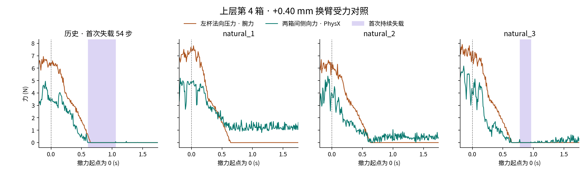

# 上层第 4 箱 +0.40 mm 的换臂持续失载复现

从同一上层第 4 箱实测断点恢复，活动箱沿 +Y 偏置 0.40 mm。先独立串行采集原动作，再用 PhysX 判断是否实际出现换臂期持续失载。两种估计器使用同一条物理轨迹和以往的冻结判据。原被动融合的源码哈希前缀为 `8f90aaf4`，腕力与末端运动模型源码为 `528c0aab`，参数为 `fbef1f84`。检测结果按传感器实际可用时间顺序回放，物理参考只参与评分。[实验方案](protocol.md) · [冻结的持续接触判据](../u4_sustained/README.md)

## 物理复现

三个试次使用字节相同的 +0.40 mm 断点，各自重启 Isaac Sim，累计 48,174 个同步步。第三次出现 8 段至少连续 12 步的换臂失载，最长 71 步。第一次换臂期全程承载，第二次只有 21 段单步失载和一段两步失载。两种对照均在原动作下获得，三次沿用既有压紧设置。[运行结果与断点哈希](physical_outcomes.json)

| 试次 | 撤力前左腕中位数（N） | 换臂有载 / 无载（步） | 左杯离开后首 1.5 s 有载 / 无载（步） | 最长连续失载（步） | 物理运行结果 |
| --- | ---: | ---: | ---: | ---: | --- |
| [第一次](natural_1/handoff_counts.json) | 7.190 | 1647 / 0 | 180 / 0 | 0 | 后推时右腕达到 9.736 N，触发停止 |
| [第二次](natural_2/handoff_counts.json) | 6.332 | 1624 / 23 | 179 / 1 | 2 | 稳定就位 |
| [第三次](natural_3/handoff_counts.json) | 7.120 | 957 / 690 | 88 / 92 | 71 | 稳定就位 |

第一次左杯离开后，侧邻箱连续承载 1,569 步（13.075 s），直到右臂开始后推。第三次先在撤力后 0.667 s 确认左杯离开，再过 14 步出现首段持续失载。图中展示初始 1.75 s，后续 71 步的失载从 9.808 s 开始。[第三次逐步数据](natural_3/timeline.csv.gz)



## 两套冻结判据的同轨对照

以下时间从左臂开始撤力算起。前两次在换臂期没有持续失载，阈值为 12 个连续物理步。首次失载和首次回载在独立复跑中各只有一个符合评分条件的事件，两套方法的命中均为 0/1。

| 第三次的事件 | PhysX 起点 | 持续时长 | 被动融合 | 腕力与末端运动融合 |
| --- | ---: | ---: | --- | --- |
| 首次持续失载 | 0.783 s | 21 步 / 175 ms | 漏检 | 漏检 |
| 其后首次持续回载 | 1.550 s | 14 步 / 117 ms | 漏检 | 漏检 |

用至少 24 步作敏感性对照，首个符合条件的失载持续 71 步，其后首个符合条件的回载持续 113 步，两套方法仍均漏检。误报按三次同轨数据汇总，分母是各窗口内具有相反真值的物理步。[完整计数](handoff_summary.json)

| 窗口 | 误报类别 | 被动融合 | 腕力与末端运动融合 | 错误三步报警（被动 → 腕力与运动） |
| --- | --- | ---: | ---: | ---: |
| 换臂 | 误报脱开 | 43/4,228（1.02%） | 44/4,228（1.04%） | 3 → 3 |
| 换臂 | 误报承载 | 3/713（0.42%） | 11/713（1.54%） | 0 → 1 |
| 右臂后推 | 误报脱开 | 477/7,205（6.62%） | 477/7,205（6.62%） | 118 → 118 |
| 右臂后推 | 误报承载 | 184/2,781（6.62%） | 186/2,781（6.69%） | 42 → 42 |

## 第三次为何漏检

首次失载和回载共 35 步均显示融合证据不足。此时左杯已离开，左腕法向力中位数在两段分别约为 −0.0016 N 和 +0.0005 N，PhysX 记录的箱间侧载中位数却从 0 变到 0.264 N。右臂 TCP 沿 X 的位移范围在两个事件内均小于 1 µm。相机估算的侧向间隙分别在 −4.118 至 −3.633 mm、−3.763 至 −3.596 mm，区间有重叠，两段观测年龄均落在 33–92 ms 内。此时腕力、运动与视觉在实测记录中缺少一致的变化，无法可靠区分这两次事件。[第三次逐步数据](natural_3/timeline.csv.gz)

## 历史参照

此前的 +0.40 mm 目标事件从左臂开始撤力后 0.608 s 起，连续 54 步无侧载。首次至少 12 步持续回载在 18.475 s 出现，持续 22 步。撤力前 12 步左腕世界 −X 力的中位数为 6.377 N。此前另三条 +0.40 mm 记录在同窗口的中位数是 7.195、7.693 和 6.877 N。该力反映左腕对箱体的压紧，实际侧邻箱法向力用 PhysX 接触对单列。历史差异用于说明重复启动时的条件波动。[54 步时序与传感诊断](../u4_sustained/diagnosis.json)

历史 54 步事件在左杯确认离开前开始。冻结的腕力与末端运动判据在事件开始后 50 ms 首次确认失载，54 步中共给出 8 步失载。被动融合漏检了此次事件。历史记录曾用于判据开发，以上独立复跑的分母只含本轮数据。[历史段评分](../u4_side_continuous/forward04/counts.json)

## 相同输入断点下的实际压紧差异

历史 54 步试次和前两次新复跑在撤力前 12 步的箱间实际侧力中位数分别为 3.716、4.736、4.601 N。历史试次与第二次新复跑的左腕中位数相近，分别为 6.377 和 6.332 N，但两箱之间的法向传力相差约 0.89 N。三次活动箱的 X 位姿中位数分别为 152.636、152.527、152.503 mm。这些是实际接触条件的差别。它们同用 +0.40 mm 输入，单独的左腕压紧力无法代表两箱间的传力状态。

## 计数口径

换臂起点取左臂开始卸载，终点取右臂开始推进。连续 12 个 120 Hz 物理步构成持续失载或回载。首次回载从首次合格失载结束后寻找，结合阶段边界说明是否发生在换臂内。估计器须在真实区间内重新发出判断并连续维持三步。按当步已知 PhysX 标签分别计误报承载、误报脱开，并记录含反向真值的三步声明。低于 0.1 N 的真实传力仍计为承载。持续时长按实际记录计算。本轮独立数据只观察到一个含持续失载的试次，误报率为同轨描述性统计。

## 复算与重新采集

在仓库根目录执行。逐次复算会校验冻结模型及参数，然后读取归档的相机、腕力、运动学和 PhysX 配对流。

```bash
e=scenes/w760_300mm_two_layer/experiments
r="$e/results/u4_preload_repeat"
for packet in "$r"/*/paired.jsonl.gz; do
  python3 "$e/u4_preload_repeat_score.py" "$(dirname "$packet")"
done
python3 "$e/u4_preload_repeat_score.py" --summary "$r"
python3 "$e/u4_preload_repeat_plot.py" "$r" "$e/results/u4_side_continuous/forward04"
```

以下命令用同一个 +0.40 mm 输入依次启动三个独立试次。每次执行都等待前一实例退出。力限中断的运行仍可用 `--allow-incomplete` 打包已观测前缀。

```bash
e=scenes/w760_300mm_two_layer/experiments
scene=scenes/w760_300mm_two_layer
isaac_dir=/home/ubuntu2004/isaacsim-4.5.0
batch=$(mktemp -d)
PYTHONPATH="$e" python3 - "$scene" "$batch" <<'PY'
import json, sys
from pathlib import Path
from u4_handover_capture import checkpoint

scene, batch = map(Path, sys.argv[1:])
source = (scene / "validation/upper4_after_transfer_checkpoint.json").read_bytes()
(batch / "forward04.json").write_text(json.dumps(checkpoint(source, .0004), indent=2) + "\n")
PY
for n in 1 2 3; do
  trial="$batch/natural_$n"
  "$isaac_dir/python.sh" "$scene/two_row_physx.py" "$trial" --resume "$batch/forward04.json" --close-on-finish
  out="$batch/paired/natural_$n"
  python3 "$e/seven_dataset.py" "$trial" u4 "$out/paired.jsonl.gz" --allow-incomplete
  python3 "$e/u4_command_y.py" "$trial" "$out/paired.jsonl.gz" "$isaac_dir" "$out/right_commands.json.gz"
  python3 "$e/u4_preload_repeat_score.py" "$out"
done
python3 "$e/u4_preload_repeat_score.py" --summary "$batch/paired"
```
