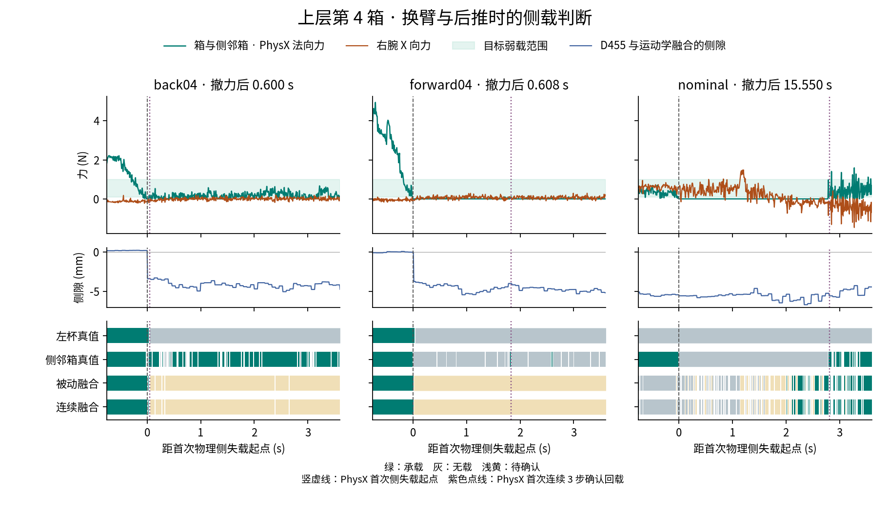

# 上层第 4 箱换臂后的连续侧载判断

在双 FR3、76 cm 宽托盘、30 cm 高墙场景中，从实测上层第 4 箱跨缝后断点恢复。左臂仍沿 −X 正常撤力，右臂随后沿 +Y 向后推。对同一个物理步，分别用原被动融合和逐步更新的侧载判据给出结果，再与 PhysX 的两箱接触对照。PhysX 只参与两套观察器的事后评分，原码垛控制器仍依其既有条件执行。[实验方案](protocol.md) · [上一轮一次撤力判断](../u4_left_unload/README.md)

**逐步更新保留了原误报水平，但没有减少首次失载或首次回载的漏检。** 三次独立运行均完成换臂并进入后推。两路分别认出 1/3 次首次失载和 0/3 次首次回载。去掉待确认区间可以多识别一部分变化，但换臂期误报承载及误报脱开均大幅增加。

## 连续判断怎样更新

每个物理步重新计算一次。用最近 6 步腕力和编码器数据，取前、后各 3 步的中位数及变化量。输入包括右腕 X 向力和绕 Z 力矩、两腕的工具法向压紧力、右 TCP 的 X/Y 变化和经原补偿的 D455 侧隙。相机数据不超过 0.16 s，箱面估计间隙绝对值不超过 12 mm。还要求右前杯维持推压、左杯已进入低载阶段。新判据补充原融合的待确认项。每步都重新判断，证据不充分时当步恢复原被动结果。

用 15 条已有仿真的撤力和后推片段拟合带正则的线性分数。旧有主动探测试次只取干预之前的数据。训练按运行和类别加权，采用各类得分的极值划定待确认区间。留一以整条仿真轨迹为单位。历史换臂的弱载召回两路均为 320/8,999，误报承载均为 78/7,622，误报脱开均为 83/11,233。历史后推有少量新增命中和误报，因此新运行仍独立检验误报。阈值敏感性检查使用同一个分数，另试待确认区间缩半、缩到中点两个事先定下的设置。[观察器源码](../../u4_side_continuous.py) · [历史校准和留一结果](../u4_side_continuous_calibration.json)

## 摄像机能覆盖哪些失载

历史六条换臂与后推记录的首次持续失载分别覆盖 73、20、5、3、3、3 步。在四段仅 3–5 步的失载中，均未在失载结束前收到失载发生后拍摄的图像。三次换臂记录的这一时段每 8 个物理步到达一帧有效检测，约 15 Hz，拍摄到送达的中位时间约 33 ms。左臂开始撤力后的 0.71–2.08 s 内，D455 对活动箱 X 位移的估计峰峰值为 1.20–1.78 mm。相同窗口 PhysX 中的箱体 X 峰峰位移只有 0.63–0.72 µm。这个对照支持用视觉约束邻近关系，由腕力提供短时变化信息。图中用作判据的侧隙还包括原有的运动学补偿。[历史换臂和后推](../u4_handover/README.md) · [历史撤力曲线实验](../u4_left_unload/README.md)

## 独立运行和同轨评分

从同一上层第 4 箱断点启动三次，初始箱体 Y 偏置依次为 0、+0.40、−0.40 mm。每个试次独立初始化，始终只有一个 Isaac Sim 实例。两次偏置试次稳定就位。原位试次实测右腕达到 9.131 N，在后推阶段触及既有腕力上限，计入停止前数据。三次合计 47,570 个同步物理步。后推 S6 真值来自两次稳定就位的试次。[物理结果与原始来源哈希](physical_outcomes.json)

| 指标 | 召回率 被动 → 连续 | 误报率 被动 → 连续 |
| --- | ---: | ---: |
| 换臂期弱侧载 0.1–<1 N | 64/2,736（2.34%） → 64/2,736（2.34%） | 6/1,427（0.42%） → 6/1,427（0.42%） |
| 换臂期明确脱开 | 12/1,427（0.84%） → 12/1,427（0.84%） | 32/3,519（0.91%） → 32/3,519（0.91%） |
| 换臂期 S5 | 223/3,519（6.34%） → 223/3,519（6.34%） | 6/1,427（0.42%） → 6/1,427（0.42%） |
| 后推期 S5 | 2,731/6,889（39.64%） → 2,731/6,889（39.64%） | 241/2,505（9.62%） → 241/2,505（9.62%） |
| 后推期 S6 | 109/207（52.66%） → 109/207（52.66%） | 0/9,187（0.00%） → 0/9,187（0.00%） |

表中弱载召回以 0.1 至不足 1 N 的承载步为分母，误报承载以全部明确无侧载步为分母。误报脱开用明确承载步为分母，包括传力不足 0.1 N 的步。S5、S6 误报以其他已知状态步为分母。换臂阶段未出现 S6 真值。冻结方法在三次整轨只新增两步正确的无载判断，一步在原位试次后推，一步在 +0.40 mm 试次撤臂，均未形成新的三步事件。[逐组分子与分母](summary.json)

## 首次失载和回载的时刻

时间从左臂开始撤力计。PhysX 列报告持续区间的起点，相应判据至少连续三步给出一致结果才确认。两路必须在真值区间内开始一次新的判断并完成确认。已经在报告的状态持续进入真值区间，仍可能记录为同状态重合，不算一次新的确认。

| 试次 | 首次失载起点（s） | 首次回载起点（s） | 两种方法分别确认失载（s） | 两种方法分别确认回载（s） |
| --- | ---: | ---: | ---: | ---: |
| [nominal](nominal/counts.json) | 15.550 | 18.342 | 15.625 / 15.625 | — / — |
| [forward04](forward04/counts.json) | 0.608 | 2.425 | — / — | — / — |
| [back04](back04/counts.json) | 0.600 | 0.633 | — / — | — / — |

将连续条件改为 12 步时，两路首次新报失载均为 1/3，首次新报回载均为 2/3。没有同一次试验里的两次转变都被命中。这组较长持续条件对应不同的物理事件，有助于区分短暂振荡与持续接触，逐次计时保留在评分文件中。



## 阈值敏感性

| 判据 | 首次失载命中（次） | 首次回载命中（次） | 两次转变均命中（次） | 换臂误报承载（步） | 换臂误报脱开（步） | 换臂错误三步报警 承载 / 脱开（次） |
| --- | ---: | ---: | ---: | ---: | ---: | ---: |
| 原被动融合 | 1/3 | 0/3 | 0/3 | 6 | 32 | 0 / 4 |
| 冻结连续融合 | 1/3 | 0/3 | 0/3 | 6 | 32 | 0 / 4 |
| 待确认区间缩至一半 | 1/3 | 0/3 | 0/3 | 6 | 32 | 0 / 4 |
| 取消待确认区间 | 2/3 | 2/3 | 1/3 | 674 | 1033 | 82 / 117 |

缩半在主事件口径下无新增失载和回载，后推误报承载从 242 增至 249 步，误报脱开从 533 增至 539 步。取消待确认区间在换臂期的承载误报率从 0.42% 升到 47.23%，脱开误报率从 0.91% 升到 29.35%。主试验因此保留冻结区间作为本轮结果。两个较窄设置用于量化漏检与误报的关系。

## 失载与回载在物理日志中的表现

- 原位试次先完成换臂，在后推阶段才出现首次持续失载。失载起点是撤力后 15.550 s，之后连续无载 335 步。两路均在 15.625 s 确认，比物理失载起点晚 75 ms。此前约 8.04 s 的短报警发生在真值仍承载的时段。首次真实回载始于 18.342 s，只持续 8 步，两路均未在这段完成回载确认。取消待确认区间的版本在 18.392 s 报出回载，但该原位试次换臂期已把 493 个明确承载步报成脱开，原方法为 17 步。
- 向后墙偏置 0.40 mm 的试次在撤力后 0.608 s 失载，连续 54 步无载。冻结判据在其中 48 步有有效特征，但分数落在待确认区间。首次持续回载始于 2.425 s，只持续 3 步。第三步 PhysX 侧向力 0.106 N，右腕 X 向力为 +0.072 N，估计侧隙仍约 −4.00 mm。两路均未识别这两个首次事件；取消待确认区间后识别了失载，回载仍漏检。约 450 ms 的无载期间收到了 6 帧在失载后拍摄的图像，第一帧晚于物理失载 50 ms。PhysX 箱体 X 方向峰峰位移只有 0.775 µm，有图像的较长时段也没有稳定的几何分辨信号。

- 远离后墙 0.40 mm 的试次首次失载在 0.600 s 起，持续 4 步。首次回载从 0.633 s 起，持续 7 步，起始侧力 0.130 N。4 步无载期间没有收到失载后拍摄的新图像。原判断在真实失载的 4 步里两次报承载，另外两步的连续分数仍落在待确认区间。回载后重合的承载判断在真实回载之前已经开始，未识别出新的回载事件。

## 复算

在仓库根目录执行。评分读取归档的传感数据、右臂指令和物理参考，重建每一步判断。

```bash
e=scenes/w760_300mm_two_layer/experiments
r="$e/results/u4_side_continuous"
for packet in "$r"/*/paired.jsonl.gz; do
  python3 "$e/u4_side_continuous_score.py" "$(dirname "$packet")"
done
python3 "$e/u4_side_continuous_score.py" --summary "$r"
python3 "$e/u4_left_unload_plot.py" --continuous "$r"
```

重新采集时使用一个新的输出目录。批次脚本等待当前 Isaac Sim 退出才启动下一次。再用系统 Python 整理物理和观测的配对流。

```bash
e=scenes/w760_300mm_two_layer/experiments
isaac_dir=/home/ubuntu2004/isaacsim-4.5.0
run_dir=$(mktemp -d)/continuous
python3 "$e/u4_handover_capture.py" --left-unload "$isaac_dir/python.sh" "$run_dir"
for report in "$run_dir"/*/runner_report.json; do
  trial=$(dirname "$report")
  out="$run_dir/paired/$(basename "$trial")"
  python3 "$e/seven_dataset.py" "$trial" u4 "$out/paired.jsonl.gz" --allow-incomplete
  python3 "$e/u4_command_y.py" "$trial" "$out/paired.jsonl.gz" "$isaac_dir" "$out/right_commands.json.gz"
  python3 "$e/u4_side_continuous_score.py" "$out"
done
python3 "$e/u4_side_continuous_score.py" --summary "$run_dir/paired"
```
