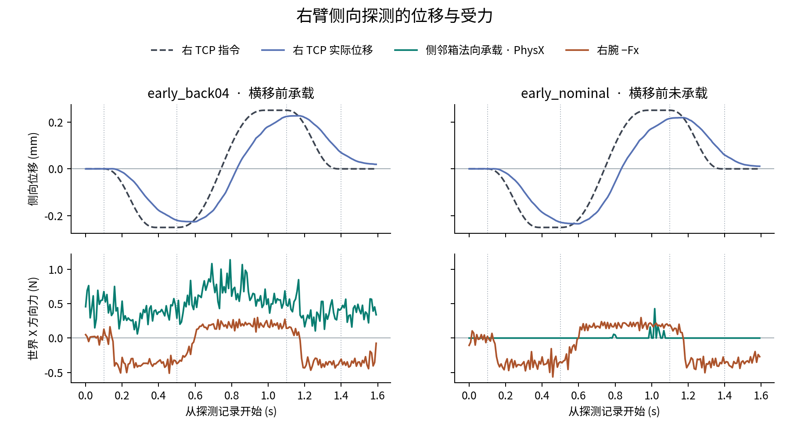

# 上层第 4 箱的主动侧向探测

**右臂从箱前侧沿世界 X 做一次 ±0.25 mm 微动，未改善换臂后 0.1 至不足 1 N 侧邻箱承载的漏检。** 三次换臂早探中，主动与被动融合对同一物理步给出相同判断。后推 S5、S6 的召回率分别为 48.75%、50.00%，增量均为 0.00 个百分点。推程补测也未得到可用的主动确证。

共从同一上层第 4 箱断点独立初始化 13 次，依次运行，同时只开一个 Isaac Sim。其中非零探测完整执行 5 次，近墙非零探测中途停止 1 次，零位移等时对照完整执行 1 次，另 6 次在预定干预前触及原有腕力上限。共 3 次码垛稳定就位。压力和召回的逐步分母都只计算实际记录。多个连续物理步属于同一试次。

实验比较同一个箱体、同一条实际轨迹上的两种判断。被动融合器读 D455 标记、两腕在 TCP 处的力和力矩、编码器及已下发的推进指令。主动融合器另读右臂当前正在执行的横向探测指令。PhysX 给出活动箱与侧邻箱、后墙在当步的法向冲量，只供评分使用。[实验方案](protocol.md) · [原被动版本](../u4_handover/README.md)

## 判定与计数

右臂每次探测用 192 个物理步（1.6 s）：采集基线，先向 −X 退 0.25 mm，在负向端短暂停留，向 +X 越过起点至 +0.25 mm，短暂停留后返回原位。既有控制器继续执行原有腕力限制。探测前状态由冻结的因果判据在归位稳定后的第 12 步回顾判定，历史预测保留原值。当步修正最多维持 1 s，几何、运动或前杯加载与探测时不再一致时提前结束。[观察器源码](../../u4_side_probe_observer.py)

弱侧载以当前 PhysX 确认的侧邻箱法向力在 0.1 至不足 1 N 之间为准。S5/S6 召回率的分母包括有物理真值而观察器待确认的步。误报率用“真值为其他已知状态、却预测为本状态”的步数除以该状态的已知负例数。估计器在同一新轨迹上的差值反映主动判据带来的改变。历史无探测轨迹与新轨迹的差异还包括动作、接触轨迹和逐次物理变化。

## 三次换臂即刻探测的主结果

| 指标 | 被动融合 | 加入侧探 | 召回率增量 | 被动误报 | 加入侧探后误报 |
| --- | ---: | ---: | ---: | ---: | ---: |
| 换臂期间侧邻箱 0.1 至不足 1 N 承载 | 131/1,826（7.17%） | 131/1,826（7.17%） | 0.00 个百分点 | 113/3,522（3.21%） | 113/3,522（3.21%） |
| 向后墙推进时 S5 | 1,938/3,975（48.75%） | 1,938/3,975（48.75%） | 0.00 个百分点 | 241/2,134（11.29%） | 241/2,134（11.29%） |
| 向后墙推进时 S6 | 53/106（50.00%） | 53/106（50.00%） | 0.00 个百分点 | 0/6,003 | 0/6,003 |

S5 是工具仍接触箱体、侧邻箱或后墙有一个方向传力。S6 是这两个方向同时传力。三次早探均完整执行。一箱稳定就位，另外两次在随后向后墙推进时触及 9 N 腕力限制。这两次已观测的步数均进入评分，后续未发生的 S6 没有分母。全部 106 个右推 S6 真值步均来自远离后墙 0.40 mm 的一次运行。该次后墙在右推开始后 32.642 s 首次承载，两个估计器都在 32.983 s 连续第三步确认，晚 0.342 s。

两路在三次早探的同一步上没有新增误报，但探测期间被动判据本身已将 376 个无侧载步中的 87 步误报为有载（23.14%），主动判据在证据不足时沿用这个判断。将三个早探与同偏置历史无动作轨迹按共同的右推步数截齐后，两边均用原被动判据，其 S5 召回率相差 +0.38 个百分点、S6 相差 −6.11 个百分点。两批物理轨迹的实际承载和中断时刻各不相同。这组跨运行差值不能用于推算分类器增益。[逐组分母、误报与历史对照](summary.md)

## 换臂即刻探测的实测响应

| 初始 Y 偏置 | 横移前 12 步的侧载中位数 | 探测中与回位后的 PhysX 结果 | 右腕卸载幅度 / 回到零位前的力增量 | 箱体 X 峰峰位移 |
| --- | ---: | --- | ---: | ---: |
| 0 | 0 N | 正向行程出现 8 步短接触（最长连续 2 步），回位后 0/24 步承载 | 0.326 / 0.522 N | 1.13 µm |
| +0.40 mm（靠近后墙） | 0 N | 192 步均无侧载 | 0.303 / 0.513 N | 1.21 µm |
| −0.40 mm（远离后墙） | 0.550 N | 192 步均承载，回位后 24/24 步均为弱载，中位 0.399 N | 0.378 / 0.490 N | 0.58 µm |

三个早探试次的右腕均出现明显切向反力。持续承载与全程脱开时，回到零位前的力增量仅相差 0.023 N。吸盘从前面抵住箱体，TCP 的横向运动传到箱体后的位移很小，单独一个腕部切向读数无法定位载荷来自哪个接触面。弱载正例回到零位前，右前杯法向压紧力降到约 0.280 N，低于原判据的 0.30 N 门槛。此时标记年龄约 50 ms，侧向估计间隙约 −4.15 mm。即使略微降低该压力门槛，正向阻力增量（0.177 N）仍小于卸载幅度（0.378 N），不能满足冻结的方向性条件。



虚线为 TCP 指令，蓝线为编码器正运动学位移，绿线为 PhysX 对侧邻箱的法向力，棕线为右腕在世界 −X 方向的力。左图是持续承载的真实正例，右图原本已脱开，正向行程短暂产生新接触。图中全部数据来自实际仿真步。

## 其余独立试次与中断

原定右推 2.5 s 的两次试验在左臂横推阶段分别触及 9.082 N 和 9.138 N，均未到达晚探时刻。零位移对照第一次同样在进入等待段之前因左腕 9.029 N 停止。三次都保留原始记录。没有把未执行的激励记作已测试的脱开样本。最初两个近墙试次已经进入右推，在微动前分别触及右腕 9.125 N 和 9.520 N。原位试次距后墙约 10.5 mm，世界坐标力约为 [−1.27, −8.55, +2.94] N。和两次已经早探的右推停机相对照，上游横推和下层支撑交接都能在尚未执行微动时达到腕力上限，不能将停机单独归因于侧探。[试次物理结果与断点哈希](physical_outcomes.json)

零位移复验完整执行 192 步并稳定就位。进入保持前连续 12 步都有侧载，中位 0.424 N。同样 1.6 s 后的最后 24 步仍全部有侧载，中位 0.359 N。右腕后推峰值为 7.99 N。后墙在右推 34.125 s 时首次承载，两个估计器均在 34.458 s 连续第三步确认。后推 S6 均为 72/115（62.61%），误报 0/4,103。这一组单列为「相同保持时间、零横向激励」的对照。

−0.40 mm 的近墙补试实际触发了探测。启动前连续 12 步侧邻箱受载，中位 1.317 N；从第一步保持到第 24 个有遥测的物理步，侧邻箱与后墙同时受载，均为 S6。到第 24 步时，横向指令为 −0.0525 mm，右 TCP 的实测横移为 −0.00255 mm。下一步（第 15,564 步）右腕达 9.338 N，触发原控制器停机。该步两路完整日志显示侧邻箱力为 0 N、后墙力 6.792 N，真值已转为 S5，两种估计器也均报对。此次只记录到一个卸载步，后墙力也在变化。动作尚未回位，无法用此次试验确定侧移是否导致卸载。将实际 S6 环境与完整激励分开计数后，这一试次后推 S6 召回为 21/67（31.34%），误报 0/4,036，两路相同。该次后墙真实初触在右推 33.633 s，融合连续第三步确认在 34.000 s。

右推 6 s 的原位试次在介入前因左腕 9.022 N 中止。+0.40 mm 试次完整执行探测并稳定就位。介入前 12 步都有侧载，其中 9 步在弱载区间，中位 0.330 N。暂停 Y 指令后的前 12 步中位升到 1.100 N，归位后的最后 24 步全部卸载。探测期间箱体 Y 方向实际位移范围为 1.228 mm，说明固定 TCP 的 Y 指令仍可能伴随箱体运动。右腕的响应没有通过编码器行程及归位检查，这次也未产生主动确证。该次后推 S6 两路均检出 65/117，误报 0/4,373。

另一组远离后墙 0.40 mm 的 6 s 试次在介入前 11/12 步处于弱载区间，中位 0.575 N。暂停 Y 指令后为 7/12 弱载，中位 0.967 N。期间观察到侧载解除、恢复、再解除。归位后 24/24 步无侧载，箱体 Y 方向位移范围 1.307 mm。主动判据仍给出待确认。恢复 Y 推进的第二步，右腕达到 9.019 N，停机时还未到达后墙。五次完成非零激励的独立试次中，只有一次在干预前连续 12 步全部为目标弱载，两次 6 s 补测提供了动态弱载转入脱开的记录。上述结果适用于本次右前杯压住箱面时的探测方式。

## 对码垛状态判断的影响

前杯的横向力会同时受箱面处切向反力、下层支撑和后墙约束的影响。原本脱开的样本可以在探测中短暂传力，原本受载的样本也可以在归位前脱开。把这些响应一概解释为「探测前已贴紧」会造成误判。此版本将新估计器用于并行评分，码垛运动仍按既有控制器执行。可继续研究左臂沿侧邻箱法向卸载的最后一段是否能提供更直接的辨识信号。这项实验尚待验证。

## 历史数据上的弱载补判

另用四条既有轨迹逐次留一，检验改用视觉间隙、腕力与力矩、编码器运动历史进行补判的效果。换臂和后推合计 11,466 个弱载步，新增命中 92 步，召回多 0.80 个百分点。单看换臂期间的 4,452 个弱载步，新增命中为零。其中一次留出运行的换臂无载误报多了 587/1,587 步。该方法未达到事先约定的召回与误报标准，未用来调整本次独立物理试次的判断。[逐次留一试验](weak_side_loso.md)

## 重放

以下逐步评分命令从仓库根目录执行。每次输出包含逐步承载、判断、混淆计数及探测前中后的真值。已归档的配对包保留相机检测位姿和时间戳，FK 指令、腕力与物理参考可逐步核对。

```bash
e=scenes/w760_300mm_two_layer/experiments
r="$e/results/u4_side_pulse"
out=$(mktemp -d)
for score in "$r"/*/scores.json; do
  d=$(dirname "$score")
  control=$(python3 -c 'import json,sys; print(json.load(open(sys.argv[1]))["matched_no_pulse"]["source"])' "$score")
  python3 "$e/u4_pulse_score.py" "$d/paired.jsonl.gz" "$d/right_commands.json.gz" \
    "$d/u4_side_probe.jsonl" "$out/$(basename "$d")" --control "$e/results/u4_handover/$control"
done
```

在 Isaac Sim 4.5.0 上重新做物理采集时，按顺序从同一 U4 断点恢复。输出目录需使用新路径。若有试次中断，原始日志和后续试次都会保留，批次命令在最后报告未完成的试次。

```bash
e=scenes/w760_300mm_two_layer/experiments
session=$(mktemp -d)
python3 "$e/u4_handover_capture.py" --side-probe /home/ubuntu2004/isaacsim-4.5.0/python.sh "$session/runs"
```

补充组复用同一初始偏置的输入文件。批次结束后，下列命令形式可单次复现原位零动作重试、远离后墙偏置的近墙试验或定时右推 6 s 的试验。每次只运行一条，并为新的采集指定一个新输出目录。

```bash
s=scenes/w760_300mm_two_layer
/home/ubuntu2004/isaacsim-4.5.0/python.sh "$s/two_row_physx.py" "$session/sham_nominal_retry" \
  --resume "$session/runs/early_nominal.json" --close-on-finish --u4-side-probe sham
```

将末项改为 `near` 或 `weak` 即可选择近墙或 6 s 时机。初始 Y 偏置 0、+0.40、−0.40 mm 分别对应 `early_nominal.json`、`early_forward04.json`、`early_back04.json`。实际执行的时机和偏置见[试次表](summary.md)。

用归档数据重新生成统计表与图像的命令如下。

```bash
python3 "$e/u4_pulse_summary.py" "$r"
python3 "$e/u4_pulse_plot.py" "$r" early_back04 early_nominal
```
