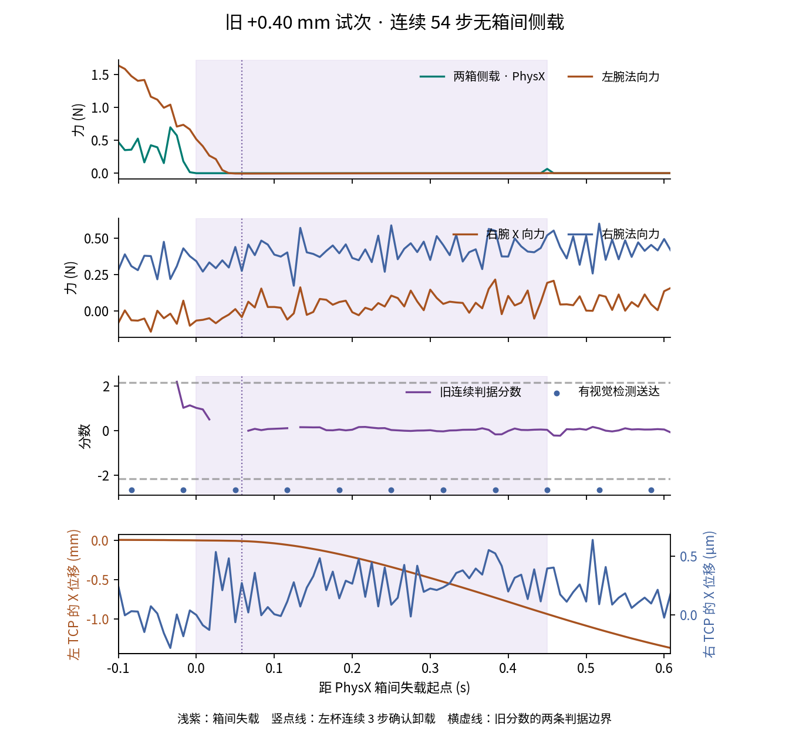

# 上层第 4 箱的持续失载、回载与短时接触变化

从同一上层第 4 箱实测断点恢复。两臂按既有撤力和后推轨迹运行。相机观测沿用原被动融合。增量判据用腕力和实测末端运动补充待确认状态。被动融合与新观察器使用相同的物理轨迹，PhysX 两箱接触对及当步法向冲量用于评分。[试验方案](protocol.md)

**历史 54 步失载的主要问题是观测信号重叠。** 右末端几乎静止，左杯确认卸载比两箱开始失载晚了 7 个物理步。新腕力与末端运动判据在历史留一回放中确认了这次失载。在三个独立复跑中，两路均识别出首次持续失载和回载，没有看到新方法提高首次事件命中。逐步脱开召回有所提高，误报也增加。

## +0.40 mm 历史试次为什么漏检

在上一轮向后墙偏移 0.40 mm 的试次中，活动箱与侧邻箱在第 10,494 至 10,547 步连续没有法向承载。以左臂开始撤力为零点，起于 0.608 s，持续 54 个 120 Hz 采样步，约 450 ms。两套旧方法在开始的 2 步报承载，其余 52 步待确认。其中 4 步未满足旧判据对右杯法向压力的要求，48 步的分数落在待确认区间。

在这 54 步里，左 TCP 沿 X 撤开约 0.910 mm，右 TCP 的 X/Y/Z 位置峰峰值只有 0.68/1.20/2.93 µm，活动箱实际 X 位移峰峰值 0.775 µm。期间收到 6 帧失载开始后拍摄的图像，首帧在起点后约 50 ms 送达。但箱间距离变化低于本次成像与位姿估计的分辨能力。箱间开始失载时，左杯仍在传力，直到第 10,501 步才连续三步确认左杯卸载。此后真实无侧载时，右腕 X 向力介于 −0.062 N 至 +0.215 N。初次再次传力的时段，该读数介于 −0.095 N 至 +0.235 N。两个范围大幅重叠。左腕曲线主要反映左杯与箱体的卸载，此时的右杯几乎静止，单靠腕力或侧隙难以确定两箱间的力链。

撤力后约 2.425 s，首次回载仅持续 3 步。第一段至少 12 步的回载直到 18.475 s 出现，持续 22 步，且处于右臂推进中。其前 12 步右 TCP 沿 Y 进给约 0.86 mm，侧载中位数 0.375 N。其间共出现 194 段不足 12 步的回载，其中 184 段持续 1–5 步。两类分别计入短时变化和持续回载。[旧模型逐步诊断](diagnosis.json) · [上一轮试次逐步数据](../u4_side_continuous/forward04/timeline.csv.gz)



## 腕力与末端运动判据

每步比较最近 30 个物理步中开头 6 步和末尾 6 步的中位数。输入包括左臂 X 和右臂 XYZ 实测位移、两腕的压紧力变化、右腕 X 向力、Z 向力和绕 Z 轴力矩变化，以及右臂在横向和推进方向的力与位移乘积。右杯需朝向 +Y 且仍有法向压紧，左杯需已进入低载阶段。只有连续三次窗口给出同类证据才补判。证据中断时立刻恢复原被动判断。相机仍用于原被动融合，增量分数不直接使用相机。

模型用 18 条历史试次的可用前缀开发，并在主动干预之前截断已归档的探测试次。两类标签只使用已有至少 12 步连续同一物理状态的样本。整条轨迹留一时，首次持续失载的命中从 6/16 增到 8/16，首次持续回载均为 9/14。换臂误报脱开从 115 增到 162 步，误报承载从 84 增到 112 步。上述 +0.40 mm 历史失载在留出该试次的折中，于 0.658 s 确认，比真实起点晚 50 ms。该事件参与过问题诊断与特征选择，这个成绩属于历史开发验证。在该折回放中，单用腕力变化或单用 TCP 运动都漏掉这次失载。完整判据形成确认时，左杯法向压紧力在窗口内下降 2.318 N，右杯只增加 0.022 N，右 TCP 平移也只有微米量级。两类信号的组合提供了失载发生的线索。新仿真使用冻结后的同一模型。[模型及留一结果](../u4_sustained_calibration.json) · [历史特征对照](../u4_sustained_ablation.json) · [观察器](../../u4_sustained_observer.py)

## 新物理复跑的同轨对照

三次从同一上层第 4 箱断点独立初始化，用原位和 ±0.40 mm 初始偏置顺序复跑，始终只运行一个 Isaac Sim。三次全部到达换臂和后推。原位和 +0.40 mm 稳定就位。−0.40 mm 在后推时因右腕达到 9.723 N 触发原有停止条件，直至中止的记录均纳入。同步记录合计 47,586 步。[各次仿真结果与来源哈希](physical_outcomes.json)

| 物理区间 | 1–5 步 | 6–11 步 | 至少 12 步 |
| --- | ---: | ---: | ---: |
| 无侧载 | 538 | 37 | 8 |
| 有侧载 | 250 | 122 | 214 |

换臂到右臂后推期间，累计 538 段无载仅持续 1–5 步，37 段持续 6–11 步，8 段达到 12 步。任一持续区间可能有多次新的判断声明，因此下表的首次事件只在每次运行计一次。末端截尾按观测时长计。

| 试次 | 持续失载起点与长度 | 两路失载时延（s） | 持续回载起点与长度 | 两路回载时延（s） |
| --- | ---: | ---: | ---: | ---: |
| [nominal](nominal/counts.json) | 15.042 s / 411 步 | 0.017 / 0.375 | 18.742 s / 22 步 | 0.025 / 0.025 |
| [forward04](forward04/counts.json) | 14.600 s / 455 步 | 0.025 / 0.025 | 18.758 s / 18 步 | 0.017 / 0.017 |
| [back04](back04/counts.json) | 15.492 s / 428 步 | 0.025 / 0.025 | 19.908 s / 12 步 | 0.033 / 0.033 |

时延按被动、腕力与运动的顺序列出。以连续至少 12 步定义持续，首次失载和首次回载，两路均为 3/3。将定义改为至少 24 步，两路仍各命中 3/3。三次的首个持续失载都出现在后推阶段。三个独立试次的换臂阶段都未记录到与旧 +0.40 mm 相似的持续失载。新模型对早期 54 步事件的识别目前由历史回放支持。

| 指标 | 召回率 被动 → 腕力与运动 | 误报率 被动 → 腕力与运动 |
| --- | ---: | ---: |
| 换臂弱侧载 | 71/4,449（1.60%） → 98/4,449（2.20%） | 0/91（0.00%） → 0/91（0.00%） |
| 换臂明确失载 | 3/91（3.30%） → 5/91（5.49%） | 48/4,854（0.99%） → 65/4,854（1.34%） |
| 换臂 S5 | 254/4,854（5.23%） → 281/4,854（5.79%） | 0/91（0.00%） → 0/91（0.00%） |
| 后推明确失载 | 1,288/2,536（50.79%） → 1,516/2,536（59.78%） | 656/7,286（9.00%） → 657/7,286（9.02%） |
| 后推 S5 | 2,886/7,081（40.76%） → 2,893/7,081（40.86%） | 219/2,741（7.99%） → 220/2,741（8.03%） |
| 后推 S6 | 134/219（61.19%） → 134/219（61.19%） | 0/9,603（0.00%） → 0/9,603（0.00%） |

后推正确识别脱开的步数由 1,288 增至 1,516，召回提高 8.99 个百分点。后推误报脱开多 1 步，换臂误报脱开多 17 步。换臂和后推合计，三步报警误报脱开从 113 增至 117 次，误报承载从 42 增至 43 次。两路都至少命中全部 8 段持续失载。持续失载正确报警由 49 增至 72 次，增量来自已检出区间内的再次确认。后推 S6 的 219 个真值步来自两个稳定就位的试次。[逐组计数与误报](summary.json)

### 新试次中的关键反例

- 新 +0.40 mm 试次的换臂阶段有 54 段断续无载，首段在 0.650 s 且仅 1 步，最长的一段为 7 步。保持近似相同的初始偏置，箱间首次持续失载从旧试次的 0.608 s 移到了新试次的 14.600 s，这一刻已经进入右臂后推阶段。持续 455 步。两套估计器均在实际失载后 25 ms 确认。
- 新原位试次，两路均识别首次持续失载，但腕力与运动判据在物理失载前一拍把 0.046 N 的真实微弱承载报成脱开。该预测与下一拍开始的被动判断连成一段。因为这段声明的起点过早，直到下一段新声明才算命中，实际确认延后至起点后 375 ms。被动融合本次在起点后 16.7 ms 确认。

## 计数与复算

连续 1–5 步、6–11 步和至少 12 步的物理区间各自计数。持续失载和回载按 12 步为主，并列 24 步的敏感性结果。算法连续三步给出同一结论，且三步都落在真实区间内，才计为新的事件。确认时延从真实区间起点计算。单个确定预测与相反真值对照计算逐步误报。三步声明中含明确相反状态就计为错误报警。若只有未知和一致的真值，记为无法核实。

在仓库根目录逐次重放旧模型诊断及独立试次。

```bash
e=scenes/w760_300mm_two_layer/experiments
r="$e/results/u4_sustained"
python3 "$e/u4_sustained_diagnose.py" "$r/diagnosis.json" --plot "$r/diagnosis.png"
for packet in "$r"/*/paired.jsonl.gz; do
  python3 "$e/u4_sustained_score.py" "$(dirname "$packet")"
done
python3 "$e/u4_sustained_score.py" --summary "$r"
```

开始物理采集需要一个新的目录。采集脚本确保前一个 Isaac Sim 退出后才开启下一次。系统 Python 负责打包，仿真安装目录也用于恢复已有的右臂指令位置。

```bash
e=scenes/w760_300mm_two_layer/experiments
isaac_dir=/home/ubuntu2004/isaacsim-4.5.0
run_dir=$(mktemp -d)/sustained
python3 "$e/u4_handover_capture.py" --left-unload "$isaac_dir/python.sh" "$run_dir"
for report in "$run_dir"/*/runner_report.json; do
  trial=$(dirname "$report")
  out="$run_dir/paired/$(basename "$trial")"
  python3 "$e/seven_dataset.py" "$trial" u4 "$out/paired.jsonl.gz" --allow-incomplete
  python3 "$e/u4_command_y.py" "$trial" "$out/paired.jsonl.gz" "$isaac_dir" "$out/right_commands.json.gz"
  python3 "$e/u4_sustained_score.py" "$out"
done
python3 "$e/u4_sustained_score.py" --summary "$run_dir/paired"
```
