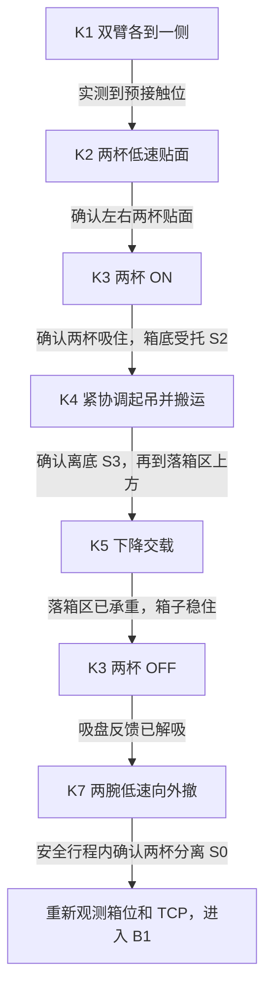
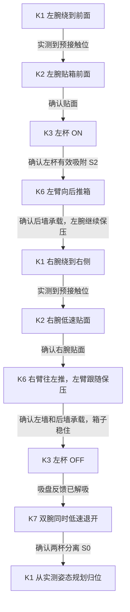

# 长时序技能与短时序状态识别

以 760 mm 托盘、300 mm 高墙、150 mm 箱体、双臂侧吸和后置 D455 拟合场景为改造起点。技能持续执行一段受控运动或操作，直到获得当前技能需要的结束证据。状态和事件根据当时实际观测更新。整段推箱可以处于同一个接触状态，一次技能内部也可以发生几次接触变化。

**验收原则是安全范围内正确识别。** 同一技能允许范围内，任何位置正确确认所需事件都算一次成功。越早识别没有额外得分。时间戳留给事后复核。避障检查约束机械臂可以怎样动，状态识别确认实际发生了什么。 [状态、事件和技能接口](long_skill_short_state.json)

[15 箱逐箱识别与技能运行线](long_skill_short_state_routes.md)

## 新状态表

| 状态 | 可观测的物理关系 | 当前用途 |
| --- | --- | --- |
| S0 工具分离，箱底受支撑 | 两侧工具均已离开箱面，箱底仍有承托 | 最终撤离后接续空载技能 |
| S1 受支撑的工具接触与推压 | 箱底有承托，至少一侧工具接触箱体，无有效侧吸 | 贴面、横推、单臂后推及有辅助臂保压的推箱 |
| S2 有侧吸，箱底仍受支撑 | 至少一侧有效侧吸，箱底仍有承托 | 吸附建立期间及落箱后待解除侧吸 |
| S3 侧吸悬持 | 有效侧吸保持，箱底已离开支撑，工具承担箱重 | 起吊、转运及短抬跨缝 |

双臂搬运要求核对两只所需吸盘。交载是否完成用「目标支撑已承重且箱体稳定」表达。侧邻箱和后墙分别记录承载对象及方向。观测不足时返回待确认，待确认属于证据质量。

新编号用于本分支的接口。原创新点二的 S4 对应新 S3。原 S3 的交载过程由支撑、侧吸和交载证据描述，原 S5 的多面承载由各承载对象描述。原有日志按原定义复算。 [创新点二原六类定义](https://github.com/dreamerToTOE/dual-fr3/blob/f35b3d257eed29aa7419ace6cc7011ebd0baee44/scenes/w760_300mm_two_layer/contact_states.md)

## 七个技能的输入、输出和结束条件

任务给技能传目标。技能生成关节、导轨或吸盘指令。观测器用 D455、关节与导轨反馈、腕力和可用的吸盘执行反馈确认实际结果，再把当时的关节角、导轨位置、TCP 和箱体估计位姿交给下一技能。TCP 表示工具中心点，位姿包含位置和朝向。

| 技能 | 输入 | 执行输出 | 观测器确认 |
| --- | --- | --- | --- |
| **K1 空载独立 RRTConnect** | 参与机械臂的实测关节、导轨与 TCP 位姿，由箱面或待机任务生成的目标 TCP 位姿，当前障碍和另一臂状态 | 无碰撞关节路径，时间参数化后得到逐步关节增量 Δq 和需要时的导轨增量 Δs | 实测 TCP 到达预接触位或空载目标 |
| **K2 低速法向贴面** | 指定腕和箱面、实测 TCP、箱面沿法向的位置、允许接近行程与速度 | 沿面法向的低速关节增量 | TCP 位于指定面附近且腕力证实贴面 |
| **K3 吸盘开关** | 吸盘列表、目标模式 ON/OFF、目标箱面。ON 需要贴面，交载后 OFF 需要目标支撑确认 | 吸盘命令及执行回执 | 通过执行反馈确认 ON/OFF 已生效。带箱还要确认有效吸附，杯面分离由 K7 确认 |
| **K4 双臂紧协调带箱规划** | 实测双臂关节和导轨、箱体起终位姿、两只 TCP 各自相对箱体的吸附位姿、起吊方向、箱体尺寸与障碍 | 箱体路径及满足共同抓持约束的双臂和导轨同步增量 | 起吊后确认离开支撑、两杯仍有效，再确认箱体到达落箱区上方 |
| **K5 落箱交载** | 当前箱位与两臂状态、目标支撑及落箱位姿、两杯抓持关系、低速下降参数 | 两臂同步下降与交载的关节增量 | 目标支撑确实承担箱重且箱位稳定 |
| **K6 受支撑带箱规划与推送** | 箱体与 TCP 实测位姿、底部支撑、允许接触、目标位姿或墙／邻箱、推进和保压方向、腕力设定、吸盘模式与有效吸附关系 | 沿支撑面的箱体路径、相应机械臂参考动作及腕力在线修正后的关节增量 | 按任务确认几何对齐、指定对象承载，或最终稳定就位 |
| **K7 低速分离** | 需要退出的腕、实测 TCP 与箱面、撤离方向、分离判据与最大安全行程 | 沿指定方向逐步外撤的关节增量 | 结合实际杯面间隙与腕力卸载确认所需腕分离。最终两杯分离且箱底受托时确认 S0 |

K1 从编码器读取起始关节构型，用目标 TCP 全位姿求逆运动学，再规划关节路径。将路径分配到各执行时间步后，用相邻关节参考值之差得到 Δq。双臂可以各有一个目标，无共同抓持约束，同步执行时仍一起核查互撞。RRTConnect 完成只代表路径已生成，K2 在实测到达预接触位后开始。 [RRTConnect 原论文](https://www.clear.rice.edu/comp450/papers/kuffner_lavalle_00.pdf)

K4 以同一个箱体路径生成两只 TCP 的目标。路径上的每一点都要满足两杯的抓持关系，并把箱体纳入避障。起吊先按低速方向离开支撑，腾空段可以用闭链约束下的 RRTConnect。现有 A 段实跑采用实测箱位注册的笛卡尔走廊和同步逆解，闭链 RRTConnect 是本接口的规划设计。 [OMPL 约束规划](https://ompl.kavrakilab.org/core/constrainedPlanning.html) · [实跑记录](observed_skills_validation.md)

K6 也规划箱体和机械臂的路径。箱底继续受托，沿允许方向移动，保压臂可根据腕力维持目标接触。已有可行直线时直接生成推送参考，需要搜索时可以在支撑和接触约束下使用 RRTConnect。两种参考都由腕力闭环执行。压推时杯为 OFF，对应 S1。吸附辅助时先调用 K3 ON，确认所需杯实际吸住后，K6 还须保持吸附腕与箱体的相对位姿，对应 S2。正常起吊或加载的腕力与相对运动可用于确认吸附。阀指令执行、有效吸附、解除吸附和杯面分离分别记证据。当前仿真吸盘接口可读取开闭状态，腕力和 TCP 与箱体的相对运动用来补充验证传力和分离。 [吸盘接口](../../fr3_surface_gripper.py)

## R1 的技能交接图

**从上料台到落箱区。** 首次用 D455 拟合 R1 的位置和朝向，从编码器与运动学得到双臂真实起点。从实测箱面生成左右腕的预接触目标。

**从落箱区到左后角。** 下图按你提出的 B1 后重新吸附来设计，先开左杯，右腕接入后负责横向压推。左腕在箱子横移时随箱移动，并继续向后墙轻压。箱底始终由托盘承托。

R1 已实跑的 B 段用的是双杯 OFF 的接触推送，左腕贴面后直接进入 K6，稳定就位后进入 K7。上图的左杯 ON 方案属于待实跑的吸附辅助对照。若只让右腕进场，K1 可以使用左腕当时的保压运动范围做互撞检查。 [R1 实跑证据](observed_skills_validation.md#r1-后排第-1-箱)

## 全流程如何调用

**共同的 A 段。** K1 → K2 → K3 ON → K4 → K5 → K3 OFF → K7。A、B 是流程阶段，每个阶段可以调用多个技能。上层短抬跨缝复用 K3 ON → K4 → K5 → K3 OFF，再接推送或分离。接近面、导轨位置、搬运目标和支撑面由各箱位的观测与场景几何确定。 [15 箱技能调用](long_skill_short_state_routes.md)

| 布置 | 横推、后推及最终就位规则 |
| --- | --- |
| 第一层后排五箱 | 历史双层拟合法入口载入后排五箱的实测就位断点。观测技能入口可从空托盘启动，从上料、交载到后墙和侧向推压。后排第 5 箱使用对槽直推。逐箱实跑进度见试验记录。 |
| 第一层前排第 1、2 箱 | 先沿 +Y 到中间位置，再分别贴左、右墙。完成侧向操作后重新观测，沿 +Y 推抵指定后排箱。左、右臂分别承担第 1、2 箱的后推。 |
| 第一层前排第 3、4 箱 | 先横向对齐并保留计划侧隙，撤开横推臂后才换另一臂沿 +Y 推入。横向结束条件是箱位和偏航。左、右臂分别承担第 3、4 箱的后推。 |
| 第一层前排第 5 箱 | 视觉确认中央槽位可通行，再由左臂直推抵住后排目标箱。需要横向修正时仍调用同一个推压技能，以位置为目标。 |
| 上层第 1–3 箱 | 复用短抬跨缝和落稳技能。主要顺序是先沿 +Y 贴后墙，再横向贴左墙、右墙或上层第 1 箱。根据箱位由前侧臂保压，第 2 箱的路线还包含第二次跨缝。 |
| 上层第 4 箱 | 跨缝落稳后，左臂沿 X 推贴上层第 2 箱，确认左杯退开，再由右臂单独沿 +Y 后推。中途换臂只要求左杯分离和箱体受支撑。最终箱体到位稳定后，确认两杯分离的 S0。 |
| 上层第 5 箱 | 确认中央槽位的姿态和间隙，由左臂沿 +Y 直推至后墙。以目标后墙承载及稳定箱位结束推压，依箱位验收规则核对两侧间隙。 |

上层第 1、3、5 箱由左臂后推，第 2、4 箱由右臂后推。相同的 S1 可以贯穿横推、保压和后推。横向对齐用位置事件切换，推到指定后墙或邻箱用对象承载事件切换。即使观察到两面传力，也需要核对其中是否有本次指定的目标。 [前排实现](front_row_skills.py) · [上层推箱实现](upper_row_push_body.txt) · [拟合法实测场景](markerless.md)

## S0 如何结束撤离技能

1. 箱体到位稳定后进入撤离。用当前姿态和障碍布局检查慢速撤离的方向及允许行程。5 mm 仅是例子，具体范围由该箱位和两个腕部周围的空间确定。
2. 外撤时用 D455 的箱面、关节与导轨编码器的杯位以及腕力卸载信息确认实际分离。允许范围内任意一处正确确认 S0 都算成功。换臂只订阅指定工具的分离事件。
3. 状态事件触发后，以测得的当时姿态接续下一技能。下一条轨迹也按自己的起点、载荷和障碍物检查。允许行程用完时停止继续外撤，将结果记为「窗口内未确认」。因此撤离技能的实际结束点可以随观测改变。

创新点二负责从传感器判定事件。创新点三负责把确认事件和实测姿态交给下一技能，包括从该处重新规划。运行时的事件证据来自 D455、腕力和编码器。PhysX 接触、吸附和运动记录用于独立核验当步事件。现有运行器里直接用于承重或到位判断的 PhysX 检查是后续迁移点。

## 改造顺序与验收

1. **固定基线。** 从已验收的视觉拟合法物理场景开始，对照创新点二的观察器和配对数据。现有运行器、断点和实测验收作为改造对照。
2. **收拢原动作。** 先按上述七项包装现有动作入口，单独暴露吸盘命令。每项提供输入、执行输出、所需结束证据与实测交接数据。K4 的闭链规划和 R1 的吸附辅助 K6 分开验收。
3. **接入感知事件。** 先在第 4 箱验证单腕分离与最终 S0，随后覆盖 A 段侧吸交载、第 5 箱直推以及其他侧靠与跨缝工况。相同步骤上同时保存传感器判断和独立 PhysX 参考。
4. **切换到新调度。** 逐个替换固定撤离点与依赖仿真真值的过渡条件，验证下一技能从实测姿态开始。在单个 Isaac Sim 实例中从可验证断点续跑，最后验证全场景。首轮验收另列第一层后排实跑覆盖。
5. **按事件评分。** 统计允许范围内正确触发、错误触发、窗口内未确认、碰撞和最终就位。记录碰撞发生在识别错误、原技能运动还是下一技能规划。每个技能机会计一次，观测到得早晚只用于复查。接触状态的逐步记录留作诊断。

观测驱动的试验入口和物理覆盖见[试验运行记录](observed_skills_validation.md)。[既有 S0 撤离旁路验收](https://github.com/dreamerToTOE/dual-fr3/blob/f35b3d257eed29aa7419ace6cc7011ebd0baee44/scenes/w760_300mm_two_layer/experiments/results/fitting_vs_aruco_20261126/s0_wrist_release.md)
