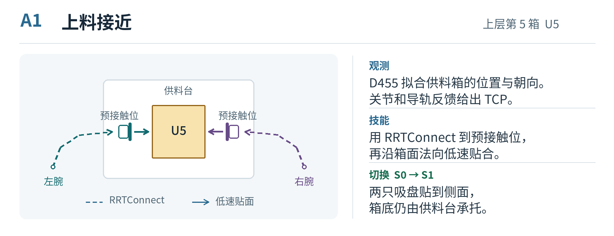
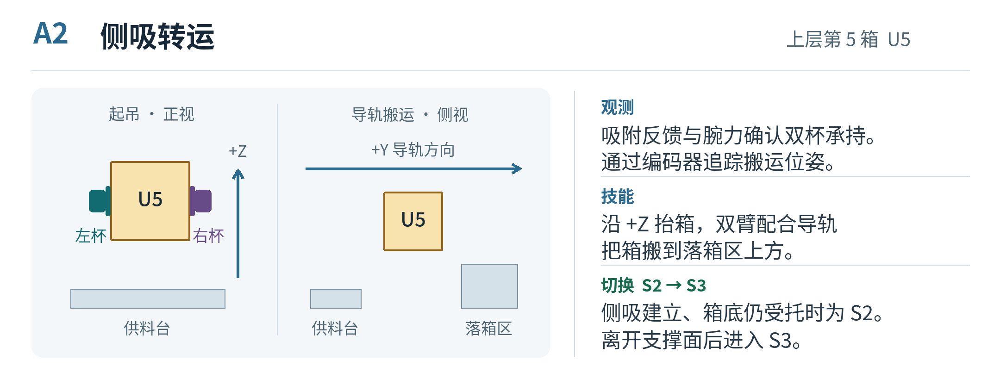
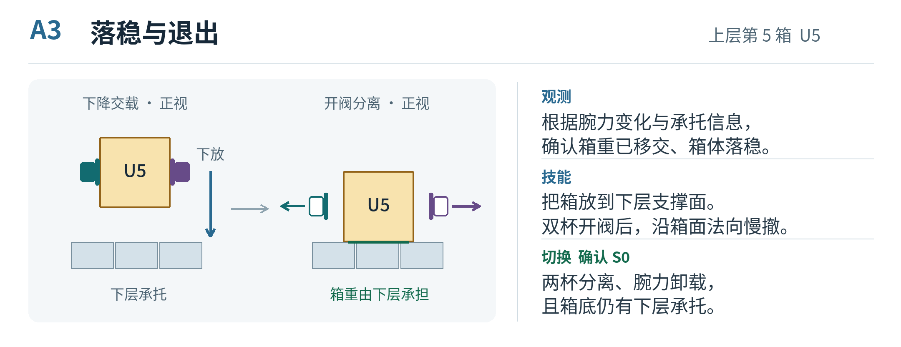
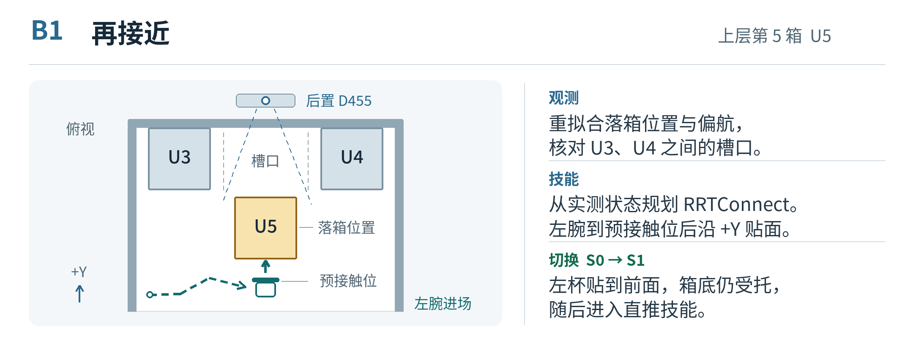
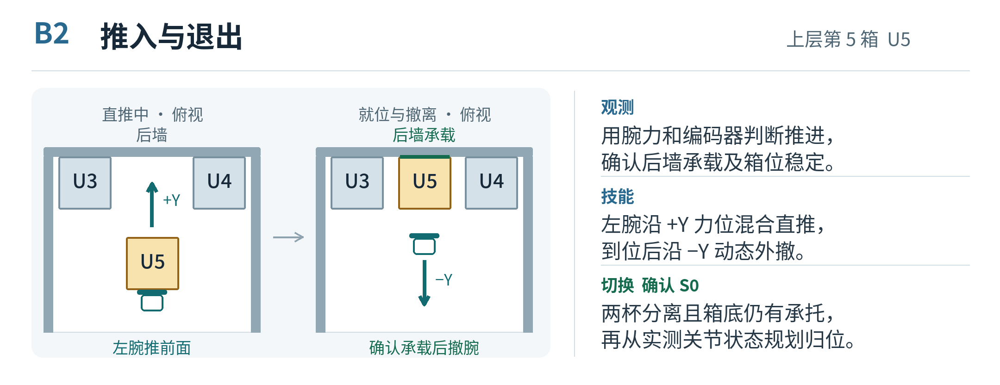

# 15 箱技能与状态运行线

每个箱位都有 A1–B2 流程图和简短说明。 [15 箱流程图解](box_skill_flows.md) · [第一层外排技能与留距复核](front_row_skill_review.md)

以下按码放顺序列出第一层后排 R1–R5、第一层前排 F1–F5、第二层靠后墙一排 U1–U5。编号是每排的第几次码放，`Cube_N` 是仿真对象。每一排从左往右的最终顺序是 1、3、5、4、2。+Y 指向后墙，+X 指向右墙。A1–B2 表示动作发生的阶段，K0–K5 表示阶段里调用的技能。 [每项技能的输入、输出与结束条件](long_skill_short_state.md) · [后排五箱技能与进场留距复核](rear_row_skill_review.md)

## 每箱共用的动作入口

| 阶段 | 先观测 | 执行技能与切换条件 |
| --- | --- | --- |
| A1 上料接近 | 相机确认箱位、朝向和可吸的竖直面。用实测关节和导轨位置计算两腕的 TCP 位姿。 | K0 空载进场 → 确认 TCP 到达预接触位 → K1 低速贴面 → 确认所需吸盘均贴面（S1）。 |
| A2 侧吸转运 | 根据托盘、下层或邻箱确定本次 landing 区和支撑面。 | K2 ON → 确认两杯有效吸附（S2）→ 启动 K3 双臂紧协调搬放，抬离支撑后进入 S3。 |
| A3 落稳与退出 | 下降时核对箱位，确认目标支撑已承担箱重。 | K3 继续下放并把箱重交给目标支撑面，落稳时仍吸住（S2），此时完成 K3 → K2 OFF → 确认真空解除 → K5 沿各自箱面法向向外慢撤 → 确认实际间隙、腕部卸载和箱底受托（S0）。 |
| B1 再接近 | 重新读取箱位和朝向、实测 TCP，以及此次要用的墙面、邻箱或槽口。 | K0 从实测姿态进场 → 确认 TCP 到达预接触位 → K1 贴面 → 确认实际接触（S1）。换臂时照此执行。 |
| B2 推入与退出 | 观察箱子是否到对齐位置、指定墙或邻箱是否承载，以及箱底支撑和箱位是否稳定。 | K4 受支撑推箱 → 观测到本段目标 → 换臂、跨缝或准备结束。最终箱位稳定后执行 K5，确认 S0 后用 K0 归位或进到下一目标。 |

速查表所列的受支撑推送用真空 OFF，接触推箱时可以一直是 S1。R1 的吸附辅助推送方案在同一 K4 接口上增加 K2 ON、有效吸附确认与结束后的 K2 OFF，另列验证。K4 的位置与力位混合模式根据本段目标结束，可使用位置到达、指定对象承载或稳定就位事件。 [R1 技能交接示例](long_skill_short_state.md)

后排 A 段的落箱区使用已验证的相对走廊。R1、R2 以标定侧墙为横向基准，R3、R4 以 D455 拟合的外侧邻箱面为横向基准，R5 取实时拟合槽口中心。纵向距离由后墙标定生成，高度由支撑面和箱高生成。

## 15 箱技能调用速查

每箱先走上表的 A1–A3。下表按实跑动作顺序标注 landing 之后的技能。「进场贴面」是重看箱位和 TCP 后执行 K0、K1。「退出」是箱位稳定 → K5 → 确认 S0 → K0 归位。K4 推到墙或邻箱时以实际承载为准，推到横向对齐处时以箱位与朝向为准。

上层的「跨缝」按需先用 K4 滑到缝前，再执行 K2 ON → 确认两杯吸住 → K3 短抬跨缝并放稳 → 确认新支撑承重 → K2 OFF。解除吸附后重看箱位。U1–U3 先用 K1 复贴前面，再用 K4 恢复后墙承载，最后用 K1 复贴侧面。U4 落稳复贴两面后直接准备横推。U1、U2 使用观测到的下层箱边缘定位接缝，U3、U4 根据实测目标箱位和相对偏移确定跨缝终点。

| 箱位 | 落稳后的技能顺序 |
| --- | --- |
| R1 | 左腕进场贴前面 → K4 后推，确认后墙承载后由左腕轻压 → 右腕进场贴右侧 → K4 向左贴左墙，左腕随箱横移并保压 → 确认后墙与左墙承载、箱位稳定 → 双腕退出。 |
| R2 | 右腕进场贴前面 → K4 后推，确认后墙承载后由右腕轻压 → 左腕从上方对准再下降到预接触位，随后贴左侧 → K4 向右贴右墙，右腕随箱横移并保压 → 确认后墙与右墙承载、箱位稳定 → 双腕退出。 |
| R3 | 左腕进场贴前面 → K4 后推，确认后墙承载后由左腕轻压 → 右腕从上方对准再下降到预接触位，随后贴右侧 → K4 向左贴 R1，左腕随箱横移并保压 → 确认 R1 与后墙承载、箱位稳定 → 双腕退出。 |
| R4 | 右腕进场贴前面 → K4 推到依据 R2 实测位置确定的横推区 → 左腕进场贴左侧 → K4 向右贴 R2，确认 R2 承载 → K5 左腕分离，右腕仍贴面，保持 S1 → K0 左腕归位 → K1 右腕复贴 → K4 右腕推至后墙承载、箱位稳定 → 右腕退出。 |
| R5 | 由相机和箱体偏航核对 R3、R4 之间的两侧通行余量 → 左腕进场贴前面 → K4 单腕直推至后墙承载、箱位稳定 → 左腕退出。 |
| F1 | 左腕进场贴前面 → K4 后推至横推区 → 右腕进场贴右侧 → K4 向左贴左墙 → K5 先右腕、再左腕分离 → 确认 S0 → K0 双腕让出视野 → 重看箱位 → 左腕进场贴前面 → K4 直推至 R1 → 左腕退出。 |
| F2 | 右腕进场贴前面 → K4 后推至横推区 → 左腕进场贴左侧 → K4 向右贴右墙 → K5 先左腕、再右腕分离 → 确认 S0 → K0 双腕让出视野 → 重看箱位 → 右腕进场贴前面 → K4 直推至 R2 → 右腕退出。 |
| F3 | 右腕进场贴右侧 → K4 向左对齐 F1 并留侧隙 → K5 右腕分离 → 复核箱位和朝向 → 左腕进场贴前面 → K4 直推至 R3 → 左腕退出。 |
| F4 | 左腕进场贴左侧 → K4 向右对齐 F2 并留侧隙 → K5 左腕分离 → 复核箱位和朝向 → 右腕进场贴前面 → K4 直推至 R4 → 右腕退出。 |
| F5 | 看 F3、F4 间的槽口 → 如需微调，右腕进场贴右侧后用 K4 向左小推，再用 K5 分离并重看槽口 → 槽口可通行后左腕进场贴前面 → K4 直推至 R5 → 左腕退出。 |
| U1 | 左腕进场贴前面 → K4 后推至后墙 → 右腕进场贴右侧 → 向左跨缝一次 → K4 恢复后墙承载 → K4 右腕向左贴左墙，左腕保压 → 双腕退出。 |
| U2 | 右腕进场贴前面 → K4 后推至后墙 → 左腕进场贴左侧 → 向右跨缝两次，每次落稳后用 K4 恢复后墙承载 → K4 左腕向右贴右墙，右腕保压 → 双腕退出。 |
| U3 | 左腕进场贴前面 → K4 后推至后墙 → 右腕进场贴右侧 → 向左跨缝一次 → K4 恢复后墙承载 → K4 右腕向左贴 U1，左腕保压 → 双腕退出。 |
| U4 | 右腕进场贴前面 → 左腕进场贴左侧 → 向右跨缝一次 → K4 左腕向右贴 U2，右腕协助 → K5 左腕分离，箱底仍受托 → K0 左腕归位 → K1 右腕复贴 → K4 右腕后推至后墙 → 右腕退出。 |
| U5 | 确认 U3、U4 间能通行 → 左腕进场贴前面 → K4 直推至后墙 → 左腕退出。 |

下方逐箱详表补充观察对象、箱边与槽宽等几何细节。场景尺寸、工具标定和避障余量来自配置。

## A1–B2 动作图示

五张阶段图以上层第 5 箱（U5）为例，每张可以包含多个技能。蓝绿表示左腕，紫色表示右腕，黄色表示本次码放的箱体。吸盘图标实心表示真空吸附有效，空心表示真空关闭。为便于观察，图中放大了槽口间隙。其他箱位的横推、跨缝与换臂顺序见下方逐箱运行线。

### A1 上料接近

### A2 侧吸转运

### A3 落稳与退出

### B1 再接近

### B2 推入与退出

## 第一层后排 R1–R5

| 箱位 | A 段吸附面 | A3 之后的逐箱运行线 |
| --- | --- | --- |
| R1 `Cube_1` | 左右面 | 观察当前箱和左、后墙 → 左臂 B1 接近前面，确认 S1 → 左臂 +Y 推至后墙并确认后墙承载，由左臂保压 → 右臂重观测接近右面，沿 −X 推到左墙 → 确认左墙、后墙承载及箱位稳定 → 撤离 S0。 |
| R2 `Cube_2` | 左右臂分别吸后、前面 | 观察当前箱和右、后墙 → 右臂 B1 接近前面，确认 S1 → 右臂 +Y 推到后墙并保压 → 左臂重观测接近左面，沿 +X 推到右墙 → 确认右墙、后墙承载及箱位稳定 → 撤离 S0。 |
| R3 `Cube_3` | 左右面 | 观察当前箱、后墙和已放好的 R1 → 左臂 B1 接近前面，确认 S1 → 左臂 +Y 推至后墙并保压 → 右臂重观测接近右面，沿 −X 推贴 `Cube_1` → 确认目标邻箱承载、后墙承载及箱位稳定 → 撤离 S0。 |
| R4 `Cube_4` | 左右臂分别吸后、前面 | 观察当前箱、R2 和后墙 → 右臂 B1 接近前面，确认 S1 → 右臂沿 +Y 到由后墙距离与 R2 面重叠确定的侧推走廊 → 左臂重观测接近左面，沿 +X 推贴 `Cube_2` → 确认左杯已退开、箱底仍承托 → 右臂根据实时箱位沿 +Y 完成后推 → 确认后墙和目标邻箱以及箱位稳定 → 撤离 S0。 |
| R5 `Cube_5` | 左右面 | 观察 R3、R4 的实际槽隙，用槽口中心确定 A 段 landing 的横坐标 → 落箱后按实测偏航和两侧间隙核对通行条件 → 左臂 B1 接近前面，确认 S1 → 左臂沿 +Y 直推 → 确认后墙承载和箱位稳定，两侧用间隙验收 → 撤离 S0。 |

后排五箱均已在观测技能入口完成分段实跑。个别箱位的后推、横推和动态撤离从实测断点续跑。 [逐箱实跑记录](observed_skills_validation.md) · [高墙五箱历史流程](../w760_300mm/README.md)

## 第一层前排 F1–F5

| 箱位 | A 段吸附面 | A3 之后的逐箱运行线 |
| --- | --- | --- |
| F1 `Cube_12` | 左右面 | 观察第一层后排及左墙 → 左臂 B1 接近前面，确认 S1 → 沿 +Y 到由观测后排正面确定的侧推区，依据当前横向重叠核对后方支撑证据 → 右臂接近右面，沿 −X 贴左墙，左臂协同保持 → 确认左墙承载后先撤右腕，再撤左腕至 S0 → 双臂 RRTConnect 让出视野，重新拟合箱面 → 左臂再次接近前面并 +Y 推抵 `Cube_1` → 确认目标后排箱承载及箱位稳定 → 撤离 S0。 |
| F2 `Cube_15` | 左右臂分别吸后、前面 | 观察第一层后排及右墙 → 右臂 B1 接近前面，确认 S1 → 沿 +Y 到可横推区域，依据后排重叠核对后方支撑 → 左臂接近左面，沿 +X 贴右墙，右臂协同保持 → 确认右墙承载后先撤左腕，再撤右腕至 S0 → 双臂 RRTConnect 让出视野，重新拟合箱面 → 右臂重新接近前面并 +Y 推抵 `Cube_2` → 确认目标后排箱承载及箱位稳定 → 撤离 S0。 |
| F3 `Cube_13` | 左右面 | 观察已就位的 F1、R3 和当前 landing 箱位 → 右臂 B1 接近右面，确认 S1 → 右臂沿 −X 推到由 `Cube_12` 箱边测得的对齐位置，留直推所需侧隙 → 确认右杯退开，复核横向位置和偏航 → 左臂重观测接近前面，沿 +Y 直推抵住 `Cube_3` → 确认目标后排箱承载及箱位稳定 → 撤离 S0。 |
| F4 `Cube_14` | 左右臂分别吸后、前面 | 观察已就位的 F2、R4 和当前 landing 箱位 → 左臂 B1 接近左面，确认 S1 → 左臂沿 +X 推到由 `Cube_15` 箱边测得的对齐位置，留前缘通过所需侧隙 → 确认左杯退开，复核横向位置和偏航 → 右臂重观测接近前面，沿 +Y 直推抵住 `Cube_4` → 确认目标后排箱承载及箱位稳定 → 撤离 S0。 |
| F5 `Cube_6` | 左右面 | 观察 F3、F4 之间的实际槽隙和 R5 正面 → 如需小幅对齐且空间允许，先由右臂沿 −X 微调，待右杯退开后再观测槽口 → 槽口满足直推条件后左臂 B1 接近前面，确认 S1 → 左臂沿 +Y 直推抵住 `Cube_5` → 确认目标后排箱承载、箱位稳定及两侧余量 → 撤离 S0。 |

F3、F4 的横推结束依据是位置与偏航，之后留有侧隙是原方案的一部分。F1、F2 中途的后方承载对象由当时观测到的重叠关系决定；最后必须确认各自指定的 R1 或 R2。 [前排历史控制实现](front_row_skills.py)

## 第二层靠后墙一排 U1–U5

上层五箱的 A 段均从左右相对的竖直面吸附。每箱先确认落在实测下层的支撑区域，U1–U4 在前面和相邻侧面分别吸附，短抬跨缝。下表的「跨缝」包含建立承持和落稳后再贴面的过程。

| 箱位 | A3 之后的逐箱运行线 |
| --- | --- |
| U1 `Cube_7` | 观察下层支撑、左墙与后墙 → 左臂 B1 接近前面，确认 S1 → 左臂 +Y 推到后墙 → 右臂接近右面，两腕侧吸跨缝至箱底与实测外侧承托重叠约三分之一箱宽 → 确认新支撑，重观测并恢复后墙承载 → 右臂沿 −X 推贴左墙，左臂保压 → 确认左墙、后墙与上层箱位稳定 → 两腕同时分离，确认 S0 后联合 RRTConnect 归位。 |
| U2 `Cube_8` | 观察下层右侧支撑和接缝、右墙与后墙 → 右臂 B1 接近前面，确认 S1 → 右臂 +Y 推到后墙 → 左臂接近左面，与右前臂协调向右移动 → 按实测路线跨第一道接缝及 `Cube_4`／`Cube_2` 之间第二道接缝。每次落稳后重观测并恢复后墙承载 → 左臂沿 +X 推贴右墙，右臂保压 → 确认右墙、后墙和箱位稳定 → 撤离 S0。 |
| U3 `Cube_9` | 观察后墙、下层承托和 U1 的相邻面 → 左臂 B1 接近前面，确认 S1 → 左臂 +Y 推到后墙 → 右臂接近右面，到接缝位置短抬跨缝 → 落稳、重观测并恢复后墙承载 → 右臂沿 −X 推贴 `Cube_7`，左臂保压 → 确认目标邻箱、后墙及箱位稳定 → 撤离 S0。 |
| U4 `Cube_10` | 观察后墙、下层承托、U2 相邻面与 U3 避障轮廓 → 右臂 B1 接近前面支承，左臂按当前箱面接近左面 → 到接缝位置短抬跨缝 → 落稳重观测，左臂在右腕前侧辅助下沿 +X 推贴 `Cube_8` → 确认左杯退开、箱底承托 → 右臂依据当次箱面估计低速复贴前面，再单独沿 +Y 后推 → 确认后墙承载、箱位稳定 → 两杯分离确认 S0。 |
| U5 `Cube_11` | 观察 U3、U4 两侧实际槽口和箱体偏航 → 确认槽口通行后，左臂 B1 接近前面，确认 S1 → 左臂沿 +Y 直推至后墙 → 确认后墙承载和稳定箱位，并核查两侧间隙 → 撤离 S0。 |

U4 中途换臂只订阅左杯分离和箱底承托。后墙刚开始承载时，侧向载荷可另外记录。U5 的直推以指定后墙承载及位置稳定为结果，以两侧间隙验收槽口。 [上层历史推箱实现](upper_row_push_body.txt) · [上层跨缝接入](two_row_physx.py)

## 覆盖与验证口径

这套线路涵盖 15 个箱位的技能输入、物理证据和后继技能。现有物理基线的拟合法分段验收主动跑了前排 F1–F5 和上层 U1–U5，后排 R1–R5 在同一入口从实测就位断点恢复。历史物理结果用于对照。动态目标、在线状态切换和撤离的逐箱物理结果按改造分支的单实例实跑记录判断。 [15 箱拟合法基线与验收范围](markerless.md)

15 个箱位均有单实例分段实跑就位证据。最后一次试验从本分支 U4 的实测断点开始，完成 U5 的供料侧吸、搬运、直推和撤离，生成了 15 箱最终布局。各箱位的阶段覆盖、历史断点来源和控制中剩余的 PhysX 依赖见运行记录。 [观测驱动实跑记录](observed_skills_validation.md) · [15 箱最终布局](validation/observed/upper5_complete_checkpoint.json)
